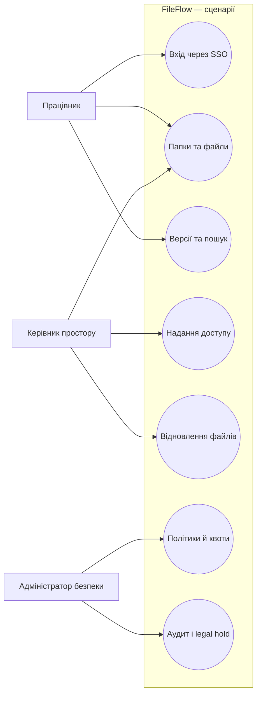
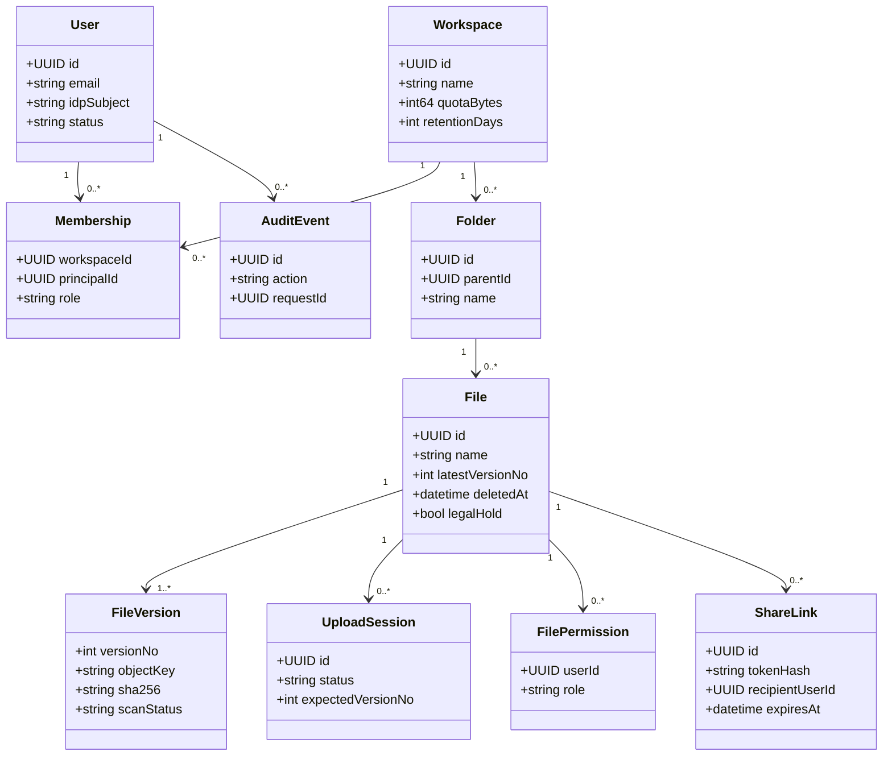

# 3. Опис продукту (Functional Specification, UML, Identity Management)

[← До вступу та змісту](../FileFlow_SRS.md)

## 2. Актори та сценарії використання

### 2.1. Actors / Personas

| Актор | Основна ціль | Доступні дії | Обмеження |
|---|---|---|---|
| **Працівник** (Employee) | Зберігати та обмінюватися робочими документами | Перегляд доступних папок, завантаження, пошук, отримання копій, створення нових версій за наявності прав | Не бачить чужих файлів і не може самостійно призначати собі права |
| **Керівник простору** (Workspace Owner) | Організувати файли команди | Усі дозволені працівнику дії, керування доступом, створення внутрішніх посилань, відновлення версій | Права обмежені належним йому простором; не змінює глобальні параметри безпеки |
| **Адміністратор безпеки** (Security Admin) | Керувати правилами збереження й контролювати ризики | Налаштування квот/retention, legal hold, перегляд журналу аудиту, деактивація доступу через IdP | **Не отримує автоматичного права читати вміст будь-якого файла** лише через адміністративну роль |

### 2.2. Діаграма основних сценаріїв

*Це спрощена use-case-подібна діаграма в Mermaid; формальні зв'язки класів наведено у [§ 6](#6-модель-даних-і-uml).*

### 2.3. Типовий користувацький сценарій (UC-01)

**Назва:** працівник завантажує документ і надає доступ колезі. **Передумови:** обидва працівники мають корпоративні облікові записи, а ініціатор має роль `EDITOR` або `OWNER` у відповідному просторі.

1. Працівник входить через SSO, обирає простір та папку.
2. Вказує документ; FileFlow створює сесію завантаження та видає короткоживучі URL для частин.
3. Браузер передає частини у сховище, після чого завершує сесію.
4. Система перевіряє контрольну суму SHA-256 та сканує документ. До результату файл має статус `PENDING_SCAN` і не видається для завантаження.
5. Після статусу `CLEAN` працівник створює посилання для конкретного колеги з визначеним строком дії.
6. Колега входить через корпоративний SSO і відкриває посилання; система перевіряє отримувача, строк дії, стан файла та видає короткоживуче посилання на скачування.

**Постумови:** документ має збережену версію, а створення, доступ і надання прав відображаються в аудиті.

## 3. Software Requirements Specification (SRS)

### 3.1. Функціональні вимоги

Кожну вимогу сформульовано як поведінку системи, яку можна перевірити тестом. `MVP` означає запланований обов'язковий функціонал, а не твердження про його фактичну реалізацію.

| ID | Вимога до системи | Критерій приймання |
|---|---|---|
| **FR-01** | Автентифікувати працівників через корпоративний OIDC SSO. | Після успішного входу доступні `GET /me` і робочі простори; неавтентифікований запит повертає `401`, деактивований користувач не отримує нову сесію. |
| **FR-02** | Показувати лише робочі простори, дозволені поточному користувачу. | `GET /workspaces` не повертає простори сторонньої команди; перевірка проводиться сервером, а не лише інтерфейсом. |
| **FR-03** | Створювати та переглядати вкладені папки. | `EDITOR` створює папку; дубль назви в одній батьківській папці повертає `409`; створення без прав — `403`. |
| **FR-04** | Завантажувати нові файли частинами без пересилання байтів через REST API. | Файл до 2 GiB передається у сховище за signed URL; повтор запиту `complete` з тією ж `Idempotency-Key` не створює додаткову версію. |
| **FR-05** | Зберігати незмінні версії файлів під час оновлення. | Заміна створює нову версію; старі версії зберігаються; якщо `expectedVersionNo` застарів, атомарна операція повертає `409 VERSION_CONFLICT`. |
| **FR-06** | Перевіряти цілісність та безпечність кожної нової версії. | Поки перевірка не завершена, версія `PENDING_SCAN`; за збігу SHA-256 і успішного сканування — `CLEAN`, інакше `REJECTED` без доступу до вмісту. |
| **FR-07** | Дозволяти скачування лише авторизованих версій зі статусом `CLEAN`. | Сервер перевіряє ACL та стан файла перед видачею signed URL; за відсутності придатної версії повертає `409` або `422`. |
| **FR-08** | Показувати історію версій та відновлювати доступну попередню версію. | Відновлення версії `CLEAN` додає **нову** версію, не змінюючи старих записів; конкурентне відновлення з неактуальним номером повертає `409`. |
| **FR-09** | Надавати або відкликати файловий доступ працівникам за ролями `VIEWER`, `EDITOR`. | Правила змінює `OWNER`; нові запити авторизуються за оновленими правами одразу після commit транзакції. |
| **FR-10** | Створювати внутрішні тимчасові посилання, обмежені конкретним одержувачем. | Лише корпоративний одержувач може відкрити посилання; TTL — 1–168 год; відкликане посилання більше не проходить `resolve`. |
| **FR-11** | Шукати файли за назвою серед дозволених метаданих. | Пошук за частиною назви не повертає файли, на які немає чинного права; вміст документів не індексується. |
| **FR-12** | Підтримувати кошик і відновлення випадково видалених файлів. | `DELETE` переводить файл у стан `TRASHED`; протягом строку retention його можна повернути; під час `PURGING` повертається `409`. |
| **FR-13** | Фіксувати критичні події в append-only журналі аудиту. | Вхід, upload, download-link, права, посилання, видалення й політики створюють записи з actor, action, result та `requestId`. |
| **FR-14** | Дозволяти адміністратору змінювати квоти та строки retention. | Доступ до API політики має лише security admin; перевищення квоти блокує нове завершення завантаження. |
| **FR-15** | Забороняти остаточне видалення файлів під legal hold. | Для `legalHold=true` фоновий purge не видаляє об'єкти; зняття legal hold не скасовує інших умов retention. |

### 3.2. Нефункціональні вимоги

| ID | Категорія | Перевірна вимога / метод перевірки |
|---|---|---|
| **NFR-01** | Доступність | Цільова доступність API метаданих **≥99,5%** за календарний місяць; перевірка uptime-моніторингом. |
| **NFR-02** | Продуктивність | Для 50 одночасно активних користувачів p95 запитів browse/search метаданих **≤700 мс** (без часу передачі файла); перевірка навантажувальним тестом. |
| **NFR-03** | Місткість | Підтримувати **до 200** активних облікових записів, **20** одночасних сесій upload та файл **до 2 GiB**; перевірка інтеграційним навантажувальним тестом. |
| **NFR-04** | Захист передавання | Усі зовнішні HTTP-з'єднання — **HTTPS/TLS 1.2+**, HTTP переадресовується на HTTPS; cookie має `Secure`, `HttpOnly`, `SameSite=Lax`; перевірка конфігурації та security tests. |
| **NFR-05** | Захист збережених даних | Приватне сховище із шифруванням на диску / server-side encryption; права доступу до об'єктів лише у FileFlow; перевірка політик сховища. |
| **NFR-06** | Надійність | Ціль відновлення після аварії: **RPO ≤24 год, RTO ≤8 год**; щоденний backup метаданих, регулярна перевірка restore; фактичні значення підтверджуються навчальним відновленням. |
| **NFR-07** | Спостережуваність | Кожен REST-запит має `requestId`; критичні дії — аудит; для upload/scan/error — метрики та логи без токенів або вмісту файлів. |
| **NFR-08** | Конкурентна коректність | Повтор завершення upload із незмінною `Idempotency-Key` не створює дублікати; одночасні оновлення файла не гублять версії; перевірка race/integration tests. |
| **NFR-09** | Сумісність | Вебінтерфейс працює в двох останніх основних версіях Chrome, Firefox і Edge; основні операції доступні з клавіатури. |
| **NFR-10** | Обмеження наслідків відкликання | Після commit відкликання прав не видаються **нові** signed download URL; раніше видані URL живуть не більш як **60 с**. Перевіряється паралельним тестом ACL/download. |

### 3.3. Зовнішні інтерфейси

- **UI:** SPA у браузері — панель просторів, список папок, завантаження, індикатор перевірки, історія версій, керування посиланнями, кошик та адміністративні екрани.
- **HTTP API:** JSON REST `/api/v1`, контракт у `FileFlow_OpenAPI.yaml`; виняток — пряме завантаження/отримання байтів через signed URL object storage.
- **IdP:** OIDC Authorization Code + PKCE, автентифікація на стороні компанії; система не зберігає паролів працівників.
- **Сховище:** приватний S3-compatible API, multipart operations, checksum та server-side encryption.
- **Доступ до БД:** лише бекенд і фоновий worker, прямий доступ із браузера відсутній.

### 3.4. Обмеження та пріоритети

Вимоги `FR-01`–`FR-15` — для навчального проєктування MVP. На етапі реалізації порядок пріоритетів: спочатку вхід/ACL, файли й завантаження, потім версії та поширення, далі пошук, retention і моніторинг. Повноцінна синхронізація desktop-клієнта перенесена до наступної версії, оскільки потребує власного протоколу відстеження змін та складної офлайн-моделі конфліктів.

## 4. Identity Management та авторизація

### 4.1. Автентифікація

FileFlow використовує корпоративний IdP як джерело правдивих даних про особу. Для вебверсії обрано **BFF із серверною сесією**, а не збереження access token у браузері:

1. Користувач переходить на `/auth/login`; бекенд формує OIDC Authorization Code + PKCE запит та переадресовує до IdP.
2. Після успішної автентифікації IdP повертає authorization code на `/auth/callback`; бекенд перевіряє `state`, `nonce` (для ID token), `iss`, `aud`, `exp`, підпис та PKCE.
3. Бекенд створює сесію в PostgreSQL та встановлює `__Host-fileflow_session` як `Secure; HttpOnly; SameSite=Lax` cookie з `Path=/` (без `Domain`). Для мутуючих JSON-запитів SPA передає додатковий `X-CSRF-Token`, отриманий через `GET /me`.
4. Кожен запит перевіряє активну сесію та права на конкретний ресурс. `POST /logout` скасовує серверну сесію.
5. Відключений у IdP користувач не створює нову сесію; чинні сесії перевіряються повторно за корпоративною політикою (наприклад, із затримкою до 5 хв). Негайна деактивація всіх сесій потребує інтеграції з подіями IdP і **не гарантується базовим MVP**.

### 4.2. Модель прав RBAC + ACL

| Роль | Читання дозволених файлів | Завантаження / редагування | Керування доступом | Політики / аудит |
|---|---|---|---|---|
| `VIEWER` | Так | Ні | Ні | Ні |
| `EDITOR` | Так | Так | Ні | Ні |
| `OWNER` | Так | Так | Так, у своєму просторі | Ні |
| `SECURITY_ADMIN` | Лише за окремо виданим ACL | Лише за окремо виданим ACL | Керування безпековими параметрами | Так |

Базові права на простір надаються через членство або корпоративну групу, а для файла можуть існувати персональні правила `VIEWER`/`EDITOR`. Коли одна особа має кілька джерел доступу, діє найбільш привілейована *дозволена* роль; видалення одного персонального правила **не скасовує** доступ, успадкований від групи чи простору. Незалежно від ACL, заблокований користувач і файл без статусу `CLEAN` не можуть одержати вміст.

**Внутрішній share-link** — окремий обмежений грант на читання для конкретного `recipientUserId`, який має пройти корпоративний SSO. Токен посилання створюється криптографічно випадково, у БД зберігається лише його хеш, а у браузерному URL токен передається через fragment (`#...`) і далі у тілі `POST /share-links/resolve`. Зовнішні адресати не підтримуються.

**Важлива межа безпеки signed URL:** неможливо надійно відкликати вже виданий прямий URL до об'єкта простим видаленням ACL в БД. Тому URL для скачування має TTL **не більше 60 секунд**. Після відкликання ACL/посилання FileFlow більше не видає нових URL, але вже видані можуть працювати до завершення TTL. Цей компроміс зафіксовано в `NFR-10`.

## 6. Модель даних і UML

### 6.1. UML-діаграма класів предметної області

### 6.2. Основні таблиці

| Таблиця | Основні поля | Призначення / обмеження |
|---|---|---|
| `users` | `id`, `idp_subject`, `email`, `status` | Локальна проєкція працівника з IdP; паролів немає |
| `sessions` | `id_hash`, `user_id`, `expires_at`, `revoked_at` | Серверні вебсесії; індекс і TTL |
| `workspaces` | `id`, `name`, `quota_bytes`, `used_bytes`, `retention_days` | Простори й політики |
| `memberships` | `workspace_id`, `principal_id`, `role` | Членство працівників/груп |
| `folders` | `id`, `workspace_id`, `parent_id`, `name` | Папки; унікальність назви в межах батька, включно з коренем (`NULLS NOT DISTINCT` або окремий індекс) |
| `files` | `id`, `folder_id`, `latest_version_no`, `deleted_at`, `purge_at`, `purge_state`, `legal_hold` | Логічний файл, стан кошика та остання зарезервована версія |
| `file_versions` | `file_id`, `version_no`, `object_key`, `sha256`, `scan_status`, `size_bytes` | Незмінний вміст і результати перевірки, `UNIQUE(file_id, version_no)` |
| `file_permissions` | `file_id`, `user_id`, `role` | Явні файлові правила доступу |
| `share_links` | `id`, `file_id`, `recipient_user_id`, `secret_hash`, `expires_at`, `revoked_at` | Тимчасовий доступ лише для внутрішнього одержувача |
| `upload_sessions` | `id`, `file_id`, `expected_version_no`, `storage_upload_id`, `state`, `expires_at` | Стан multipart-завантаження |
| `jobs` | `id`, `kind`, `payload`, `state`, `attempts`, `lease_until`, `next_run_at` | Надійна черга worker у PostgreSQL |
| `idempotency_records` | `actor_id`, `key`, `request_hash`, `stored_response`, `expires_at` | Дедуплікація повторних команд протягом 24 год |
| `audit_events` | `id`, `actor_id`, `action`, `target_id`, `result`, `request_id`, `created_at` | Append-only журнал дій |

**Інваріанти даних:** номер версії монотонно зростає; `file_versions` не змінює вміст уже записаних версій; `latest_version_no` змінюється атомарно; повертати download-link дозволено лише до найновішої *придатної* `CLEAN` версії; квота враховує всі збережені версії та тимчасові резервування, перевіряється і резервується під блокуванням рядка workspace; фізично видаляти S3-об'єкт можна лише після перевірки всіх посилань на нього та `legal_hold=false`.
