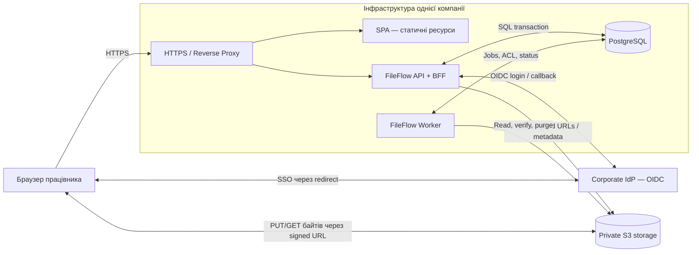
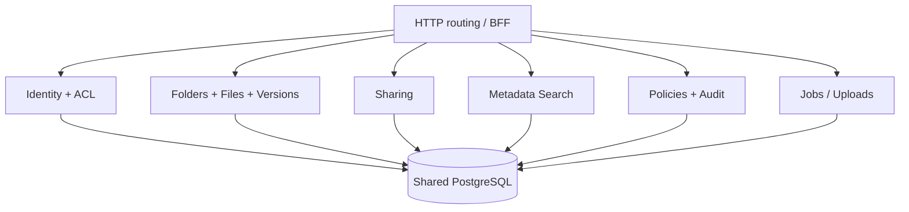
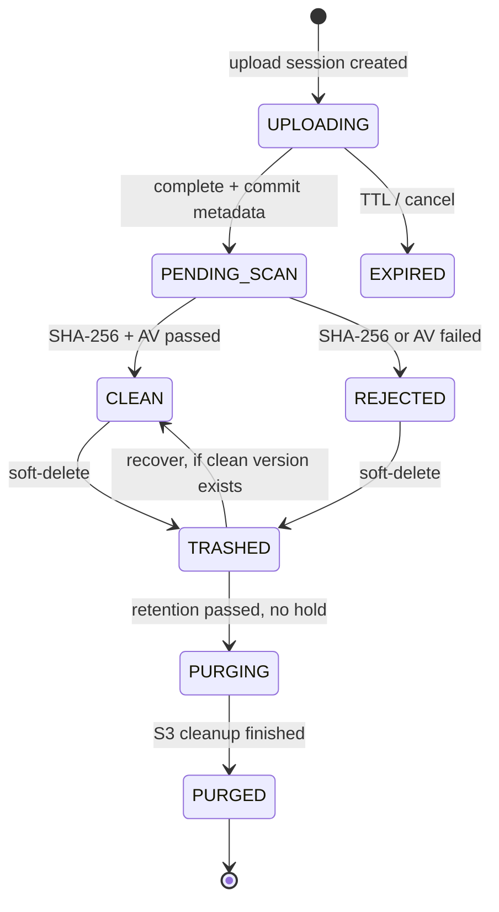

# 4. Архітектура

[← До вступу та змісту](../FileFlow_SRS.md)

## 5. High-Level Architecture

### 5.1. Архітектурний стиль і рішення

Обрана **SPA + modular monolith** архітектура. В одному застосунку працює HTTP API/BFF, а фоновий worker запускається окремим процесом з **того самого репозиторію та набору доменних модулів**. Усі модулі використовують **одну PostgreSQL БД** (єдиний транзакційний контур). Це **не мікросервіси**: окремих API Gateway, Kafka, Redis, Kubernetes, Elasticsearch або кількох незалежних БД для MVP не потрібно.

| Компонент | Відповідальність |
|---|---|
| **SPA (web)** | Інтерфейс, стан завантаження, відображення версій, доступу й помилок |
| **Backend API/BFF** | SSO-сесії, RBAC/ACL, файли, папки, версії, signed URLs, політики, пошук, аудит |
| **PostgreSQL** | Транзакційні метадані, ACL, користувачі, sessions, jobs, аудит, idempotency keys |
| **Object storage (S3-compatible)** | Реальні байти файлів, multipart upload, шифрування, lifecycle cleanup |
| **Background worker** | SHA-256, антивірусна перевірка, повторні задачі, очищення прострочених файлів і upload-сесій |
| **Corporate IdP** | Автентифікація співробітників, корпоративні групи, керування обліковими записами |

### 5.2. Контейнерна діаграма

У цьому дизайні **файлові байти не проходять через бекенд API**, тому великий upload не споживає його мережеві потоки. Бекенд виконує тільки авторизацію, видачу підписаних операцій і зміну метаданих. Сховище залишається приватним; браузер може звернутися до нього лише за адресою з конкретним методом, об'єктом і строком дії.

### 5.3. Внутрішні модулі моноліту

Вихідні коди модулів розділені логічно, але розгортаються спільно. З часом worker можна масштабувати незалежно від API, **не перетворюючи** всю систему на набір мікросервісів.

### 5.4. Ключові архітектурні рішення та компроміси

| Рішення | Аргумент | Компроміс |
|---|---|---|
| Модульний моноліт замість microservices | Менше мережевих взаємодій, одна транзакційна БД, простіший деплой для 200 працівників | Менш незалежне масштабування доменних компонентів |
| S3-compatible storage + signed URLs | Передавання великих файлів не навантажує API | Потрібно контролювати TTL підписаних URL і cleanup незавершених upload |
| PostgreSQL jobs з `FOR UPDATE SKIP LOCKED` | Фонові задачі без Kafka/RabbitMQ; перевірка й запис стану в одній БД | Не підходить для дуже великих потоків подій; потрібні retries та leases |
| PostgreSQL пошук за метаданими | Не потрібен окремий Elasticsearch | Немає повнотекстового пошуку всередині документів |
| Corporate OIDC + BFF | Немає власного зберігання паролів і браузерних access/refresh tokens | Залежність від наявності IdP та сесійної БД |
| Один регіон / один deployment | Дешевше та легше експлуатувати | Відсутній автоматичний disaster failover між регіонами |

### 5.5. Розгортання

Для MVP достатньо одного виділеного серверного середовища або віртуальної машини з Docker Compose: `reverse-proxy`, `api`, `worker`, `postgres`; окремо — кероване або сумісне з S3 приватне сховище. Рекомендовано резервне копіювання PostgreSQL, журналів конфігурації та перевірку відновлення. Якщо компанія вже має керовану PostgreSQL, її можна використовувати замість контейнера БД. Kubernetes для такого масштабу **не є обов'язковим**.

### 5.6. Основний життєвий цикл файла

Тут показано узагальнений стан файла/завантаження. У реалізації **стан `PENDING_SCAN`/`CLEAN`/`REJECTED` належить версії**, а `TRASHED`/`PURGING`/`PURGED` — життєвому циклу файла. Для оновлюваного файла попередня версія `CLEAN` залишається доступною, поки нова проходить перевірку.
