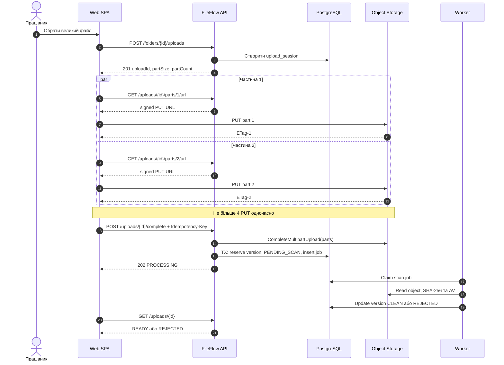
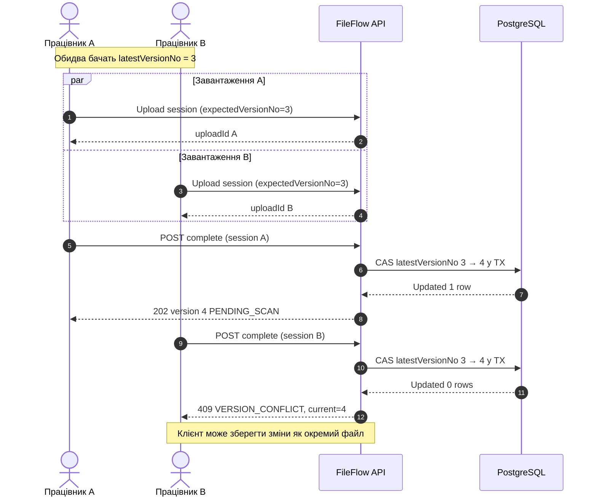
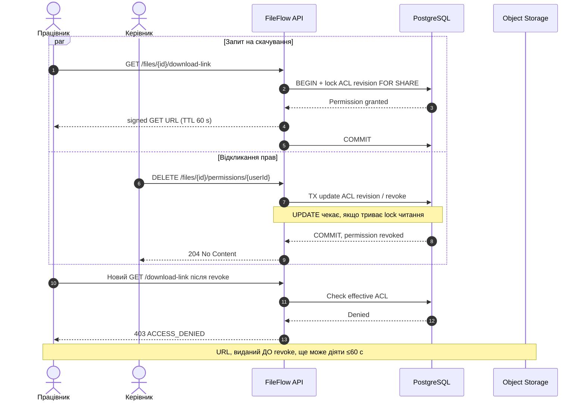
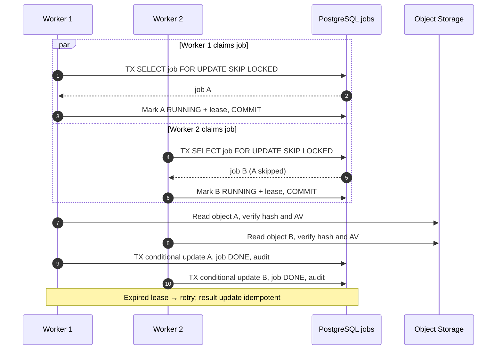
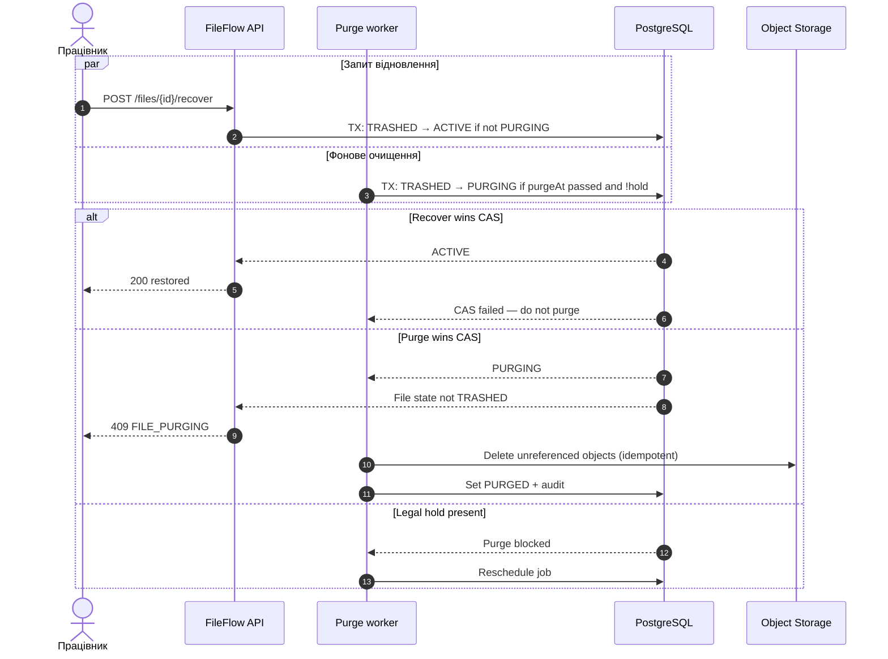

# 6. Concurrency Patterns Usage

[← До вступу та змісту](../FileFlow_SRS.md)

## 9. Concurrency Patterns Usage — п'ять сценаріїв

### C1. Паралельне завантаження частин одного файла

**Проблема.** Декілька частин одного файла передаються одночасно; спроби повторного `complete` або нестабільне з'єднання не повинні створювати дублікати версій.

**Патерни:** *bounded parallelism* (максимум 4 активних PUT), *idempotency key*, транзакційна фіксація метаданих.

**Механізм.** Клієнт використовує пул до чотирьох одночасних upload-операцій. Номери та ETag частин зберігаються у сесії. Завершення передбачає серверну перевірку списку частин та атомарне створення pending-версії. Якщо S3 об'єкт уже зібрано, але commit до БД не відбувся, об'єкт не стає видимим і видаляється фоновим cleanup.

**Гарантія / тест:** 20 паралельних сесій з повторними `complete` не повинні створювати більше однієї версії **на одну сесію**.

### C2. Двоє працівників одночасно оновлюють той самий файл

**Проблема.** Працівники A і B бачили версію `3`, обидва завантажили свої зміни. Без синхронізації другий запис міг би непомітно перезаписати перший (*lost update*).

**Патерн:** *optimistic concurrency control* через `expectedVersionNo` та атомарну операцію **compare-and-swap (CAS)** у PostgreSQL.

**Механізм.** Унікальний `(file_id, version_no)` і умова `WHERE latest_version_no = expectedVersionNo` забезпечують атомарність. Відхилена версія B не робиться поточною, однак локальні зміни B залишаються в клієнта; інтерфейс пропонує завантажити їх окремим файлом. Операція restore попередньої версії використовує ту саму перевірку.

**Гарантія / тест:** із двох конкурентних завершень при `expectedVersionNo=3` рівно одне резервує `4`, інше отримує `409`, і початкова версія `3` залишається незмінною.

### C3. Одночасне відкликання прав і спроба скачування

**Проблема.** Керівник відкликає доступ саме в момент, коли працівник запитує посилання на скачування. Не можна видавати *нові* посилання після commit відкликання прав.

**Патерни:** *transactional authorization check*, коротка критична секція з row-level locks для стану ACL, **short-lived capability** (signed URL).

**Механізм.** Перевірка ACL та видача signed URL виконуються в короткій транзакційно впорядкованій секції; відкликання змінює ревізію прав під ексклюзивним row lock. Прямий доступ до S3 **неможливо відкликати миттєво**, якщо URL уже виданий. Працівник може мати інший успадкований доступ — у такому разі видалення персонального правила саме по собі не забороняє читання.

**Гарантія / тест:** після commit відкликання, за відсутності інших грантів, новий REST-запит повертає `403`; наявні URL втрачають чинність не пізніше 60 с.

### C4. Конкурентні worker-и перевіряють файли

**Проблема.** Два worker-процеси одночасно опитують одну чергу PostgreSQL; не можна двічі виконати ефект обробки того самого job, а збій worker не повинен втратити завдання.

**Патерни:** *competing consumers*, `SELECT ... FOR UPDATE SKIP LOCKED`, *job lease*, ідемпотентний запис результатів, *bounded retries*.

**Механізм.** Claim транзакція швидко позначає роботу як `RUNNING` і встановлює `lease_until`, після чого звільняє блокування. Перевірка виконується поза транзакцією. Якщо worker завершується аварійно, інший може повторно забрати завдання після lease timeout. Запис `CLEAN`/`REJECTED` виконується лише за очікуваного стану, а audit/job completion — ідемпотентно в одній транзакції. Після трьох невдалих спроб job переходить у `FAILED` і формує алерт — жодне `PENDING_SCAN` не стає `CLEAN` за замовчуванням.

**Гарантія / тест:** один `jobId` може бути опрацьований повторно, але кінцевий стан версії та подія аудиту фіксуються **без дублювання**.

### C5. Фонове фізичне видалення проти відновлення файла

**Проблема.** Worker починає остаточне видалення після retention, а працівник майже одночасно натискає «Відновити». Не можна відновити файл, об'єкт якого вже видалений зі сховища.

**Патерни:** *state machine / conditional transition*, **CAS**, *soft-delete + delayed purge*, *idempotent cleanup*; перевірка legal hold.

**Механізм.** Відновлення і початок purge змагаються за один умовний перехід із `TRASHED`. Тільки переможець може змінити стан. Worker перевіряє `legal_hold=false`, `purge_at <= now()` та відсутність інших посилань на S3-об'єкт. Операція S3 delete повторювана: якщо видалення перерветься, job продовжиться; `PURGED` записується тільки після підтвердженого завершення.

**Гарантія / тест:** ніколи не існує `ACTIVE` файла, всі фізичні версії якого вже видалені; якщо recovery виграв перехід, purge не виконується.

### 9.6. Зведення concurrency-рішень

| Flow | Сценарій | Патерн | Яку властивість забезпечує |
|---|---|---|---|
| **C1** | Multipart upload | Bounded parallelism, idempotency | Повторне завершення не породжує зайві версії |
| **C2** | Конкурентне оновлення версії | Optimistic concurrency, CAS | Немає lost update; конфлікт виявляється через `409` |
| **C3** | Скачування vs ACL revoke | Transactional authorization, short-lived capability | Немає нових signed URL після відкликання; старі обмежені TTL |
| **C4** | Паралельне сканування | Competing consumers, SKIP LOCKED, lease | Jobs не губляться; повторна обробка не змінює результат двічі |
| **C5** | Purge vs recovery | CAS state transition, delayed cleanup | Файл не можна відновити після початку незворотного видалення |
