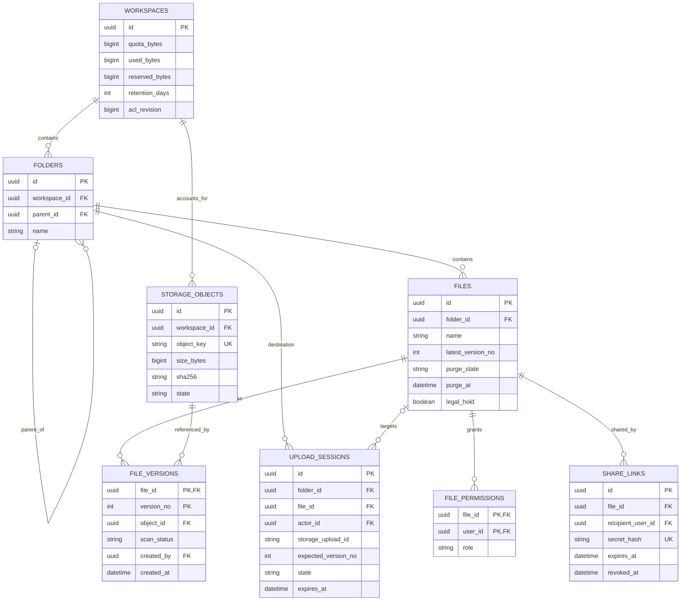
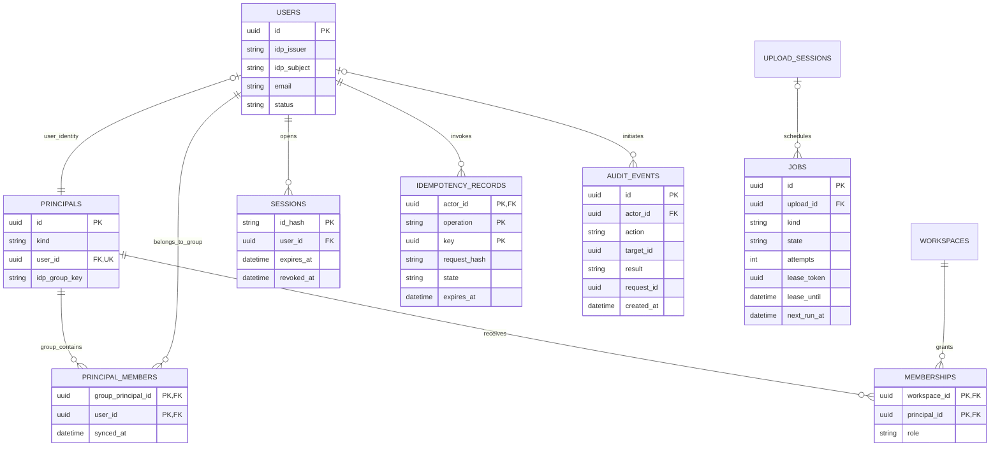

# Data model — модель даних

[← До вступу та змісту](../FileFlow_SRS.md)

**Призначення:** деталізація [моделі предметної області](./03-product-description.md) для реляційної БД і файлового сховища. Модель містить **16 основних сутностей**, дві ER-діаграми, класифікацію та retention policy, рішення щодо consensus, batching, streaming і consistency. Це проєкт схеми, а не виконані міграції. Аналітичні проєкції та агрегати поверх основних даних окремо описані в [analytics model](./11-analytics-model.md).

## 1. Межі та джерела істини

PostgreSQL зберігає метадані, права, стани, чергу й аудит. Приватне S3-сумісне сховище зберігає байти. IdP є джерелом корпоративної ідентичності; локальні користувачі й групи — його проєкція. Усі часові поля зберігаються як `timestamptz` у UTC, розміри — як `bigint` у байтах, ідентифікатори — UUID.

Назви таблиць нижче — внутрішня схема. Зовнішні JSON-поля і статуси залишаються визначеними в [OpenAPI](../FileFlow_OpenAPI.yaml). `principals`, `principal_members` і `storage_objects` деталізують раніше описані групові права та спільні посилання версій на об'єкт; нових публічних REST-операцій вони не додають.

## 2. ER-діаграми

### 2.1. Файли, версії та сховище

`file_id` у сесії нового upload може бути `NULL`: файл створюється лише під час успішного `complete`. Версія існує після commit, навіть якщо ще не пройшла scan. Для вже створеного активного файла очікується щонайменше одна версія; кардинальність `0..*` також охоплює tombstone після purge.

### 2.2. Ідентичність і службові дані

Діаграми показують основні зв'язки, а не кожен FK. `PRINCIPALS.kind=USER` має рівно один `user_id`; `GROUP` має лише `idp_group_key`. Одна людина має один USER-principal. У `PRINCIPAL_MEMBERS` дозволені лише GROUP-principal-и. `audit_events.actor_id=NULL` позначає системну подію з окремим `service_actor`. `target_id` — типізоване посилання журналу, яке зберігається після видалення ресурсу, а не FK із каскадним видаленням.

## 3. Словник сутностей та обмеження

| Сутність | Призначення й основні обмеження |
|---|---|
| `users` | Локальна ідентичність; `UNIQUE(idp_issuer, idp_subject)`. Email не є ключем авторизації; паролів немає. |
| `principals` | Єдиний FK для користувача або групи; CHECK взаємовиключних `user_id`/`idp_group_key`, унікальна група в межах issuer. |
| `principal_members` | Проєкція членства в групі; складений PK, без вкладених груп у MVP. Синхронізація змінює ACL revision відповідних просторів. |
| `memberships` | Роль `VIEWER/EDITOR/OWNER` у просторі; PK `(workspace_id, principal_id)`. Глобальна `SECURITY_ADMIN` не дає файлового гранту. |
| `sessions` | Хеш випадкового session ID, CSRF-прив'язка, TTL; індекс на користувача та строк завершення. |
| `workspaces` | Політика й облік квоти; `used_bytes >= 0`, `reserved_bytes >= 0`, `retention_days` від 1 до 365. Зменшення квоти нижче зайнятого й зарезервованого обсягу відхиляється. |
| `folders` | Дерево одного workspace; батько того самого workspace, цикли заборонені. Унікальна нормалізована назва серед дітей, з окремою перевіркою кореня. |
| `files` | Логічний файл, номер останньої зарезервованої версії, `deleted_at`, `purge_at`, `legal_hold`. Стани `ACTIVE/TRASHED/PURGING/PURGED`. |
| `file_versions` | PK `(file_id, version_no)`. Вміст незмінний; scan переходить із `PENDING_SCAN` у `CLEAN` або `REJECTED`. `downloadableVersionNo` обчислюється як найбільший CLEAN-номер. |
| `storage_objects` | Один фізичний об'єкт: випадковий `object_key`, розмір і SHA-256. Restore може посилатися на той самий об'єкт у межах одного файла. Міжфайлової дедуплікації немає. |
| `upload_sessions` | Автор, ціль, expected version, manifest частин, резерв квоти й посилання на результат. `INITIATED/PROCESSING/READY/REJECTED/CONFLICT/EXPIRED` відповідають API. |
| `file_permissions` | PK `(file_id, user_id)`, роль `VIEWER/EDITOR`. Видалення правила не скасовує незалежний membership. |
| `share_links` | Адресат, автор, хеш токена, TTL і revoke. Токен не записується відкритим текстом у таблицю або лог. |
| `jobs` | `SCAN/PURGE/CLEANUP`, `QUEUED/RUNNING/DONE/FAILED`, до 3 спроб, lease і fencing token. Унікальний ключ ефекту, наприклад `(kind, target_id, generation)`. |
| `idempotency_records` | PK `(actor_id, operation, key)`; operation включає шаблон і конкретну ціль маршруту. Хеш канонічного запиту, стан виконання, збережений результат на 24 год. |
| `audit_events` | Append-only події; `event_id`/ключ ефекту виключає дублікати. API-роль має INSERT, але не UPDATE/DELETE. Retention виконує окрема службова роль. |

Зв'язки `files → folders → workspaces`, `file_versions → storage_objects` і ціль upload перевіряються в одній транзакції, щоб не створити посилання між різними просторами. Для `jobs` потрібен індекс `(state, next_run_at)`, для версій — `(file_id, scan_status, version_no)`, для аудиту — `(created_at, id)` і `(target_id, created_at)`.

## 4. Атомарність і consistency

1. **Квота:** під блокуванням рядка workspace перевірити `used_bytes + reserved_bytes + requested_bytes <= quota_bytes`. Створення сесії резервує обсяг; commit версії переводить резерв у використання. Резерв звільняється лише після підтвердженого abort/delete або переходить в облік cleanup, доки байти ще існують.
2. **Версії:** CAS за `expectedVersionNo`, INSERT версії, job і audit — одна коротка транзакція. У конкурентних complete рівно один резервує наступний номер. Restore додає нову логічну версію, але не дублює фізичні байти та їхній облік.
3. **ACL:** один рядок `workspaces.acl_revision` є воротами авторизації: видача URL бере `FOR SHARE`, усі зміни membership, груп і файлових грантів — `FOR UPDATE`. Повторна перевірка прав відбувається після отримання блокування. У MVP немає кешу позитивного дозволу між запитами.
4. **Purge:** перехід `TRASHED → PURGING` і перевірка hold виконуються під одним блокуванням файла. Встановлення hold після початку `PURGING` відхиляється з `409`. Нове посилання/restore не може приєднати версію до файла, що видаляється. Фізичний об'єкт видаляється лише коли всі його посилання належать файлу, який успішно перейшов у purge.
5. **Дві системи зберігання:** PostgreSQL і S3 не мають спільного commit. Спершу приватний об'єкт збирається в S3, потім транзакція публікує PENDING_SCAN-метадані. Після розриву між кроками reconciler перевіряє `object_key`, upload і версії та завершує операцію або прибирає orphan. Відсутність запису в одному запиті не є достатньою підставою для delete: враховується незавершена complete-операція.

Метадані читаються з primary PostgreSQL; коректність мутацій забезпечується CAS і блокуваннями, а не припущенням, що всі транзакції автоматично серіалізовані. Scan, cleanup і аналітичні проєкції мають **eventual consistency**. Amazon S3 документує strong read-after-write consistency, але для обраного S3-сумісного продукту цю властивість треба перевірити окремо. [S3 consistency](https://docs.aws.amazon.com/AmazonS3/latest/userguide/Welcome.html#ConsistencyModel).

## 5. Consensus, batching і streaming

| Питання | Рішення для FileFlow | Межа застосування |
|---|---|---|
| **Consensus** | Один PostgreSQL primary є єдиним арбітром змін. Окремі Raft/Paxos або розподілені голосування не потрібні; workers узгоджують володіння job через транзакції. | Один primary не є відмовостійким кластером. У разі його втрати запис зупиняється; автоматичного failover немає. |
| **Batching** | Claim до 10 jobs короткою транзакцією, але не більше вільних слотів worker. Cleanup до 100 записів за прохід; аналітичні проєкції до 500 подій. | Розміри — початкові налаштування. Lease не повинен спливати, поки job лише чекає у локальному буфері. |
| **Streaming** | Браузер передає частини приблизно по 8 MiB, до 4 одночасно. Worker потоково обчислює SHA-256 і передає байти сканеру з bounded buffer. | Не читати файл до 2 GiB повністю в RAM. Якщо сканеру потрібен файл, використовувати обмежений тимчасовий диск із cleanup. |
| **Consistency** | Strong transactional invariants у PostgreSQL, асинхронний scan і reconciliation між БД та S3. | Доставка jobs щонайменше один раз; одноразовий ефект через умовний запис і ключ дедуплікації, не «exactly once execution». |

`SKIP LOCKED` підходить для конкуруючих споживачів черги, але пропуск заблокованих рядків не дає узгодженого загального знімка даних. Тому його не використовуємо для перевірки ACL чи квоти. [PostgreSQL SELECT](https://www.postgresql.org/docs/current/sql-select.html#SQL-FOR-UPDATE-SHARE).

## 6. Класифікація та data retention policy

Позначення доступу: **Internal** — внутрішні технічні дані, **Confidential** — метадані та вміст за ACL, **Restricted** — секрети й матеріали безпекового аудиту. Наведені строки — запропоновані параметри навчального MVP, не юридичні строки зберігання. `retentionDays`, межі share-link і 24-годинна ідемпотентність уже визначені API.

| Дані | Клас | Строк / початок відліку | Видалення, винятки та власник |
|---|---|---|---|
| Профіль, email, групи | Confidential | Поки користувач активний; персональні атрибути — до 30 днів після деактивації | Identity admin видаляє PII, залишає псевдонімний user ID для цілісності аудиту. |
| Сесії та CSRF-стан | Restricted | Абсолютний TTL 8 год, idle TTL 30 хв; OIDC state/nonce 5 хв | Логічна недійсність негайно на expiry/revoke; cleanup наступного добового циклу. |
| Workspace, папки, ACL | Confidential | Поки існують пов'язані ресурси | Owner керує грантами; зміни прав одразу впливають на нові запити. |
| CLEAN-версії та байти | Confidential | Поки файл ACTIVE; після soft-delete — `retentionDays`, початково 30, API допускає 1–365 | `purge_at` фіксується під час delete. Зміна політики не скорочує строк уже видаленого файла. |
| Legal hold | Restricted | До явного зняття security admin | Hold блокує видалення всіх версій і пов'язаних об'єктів незалежно від purge_at. Аудит встановлення та зняття обов'язковий. |
| REJECTED-версії | Restricted | Ті самі правила, що для версій файла; без download | Автоматично не видаляти раніше file retention. Зберігати ізольовано; hold має пріоритет. |
| Незавершені uploads і orphan objects | Confidential | Upload TTL 24 год; cleanup кожні 15 хв після expiry та перевірки незавершених операцій | Worker робить abort/delete, потім звільняє квоту. Пов'язані committed-версії не є orphan. |
| Share-link | Restricted | Чинність 1–168 год; хеш і метадані — 30 днів після expiry/revoke | Secret hash видаляється cleanup. Історія факту надання залишається в audit без токена. |
| Idempotency records | Restricted | 24 год від прийнятої команди | Для відповіді з секретним share URL — шифрований response cache під окремим ключем, без plaintext токена. Replay повторно перевіряє сесію/права та revoke. |
| Jobs | Internal | DONE 7 днів, FAILED 30 днів після завершення | Незавершені jobs не видаляються за віком. Payload містить ID, а не файл чи credential. |
| Аудит | Restricted | 180 днів від події | Окрема retention-роль; події розслідування переносяться у захищений evidence export із явно заданим строком. |
| Продуктові події / агрегати | Confidential / Internal | Сирі події 30 днів, добові агрегати 180 днів | Псевдонімні ID, без назв файлів, пошукових рядків і токенів; [аналітична модель](./11-analytics-model.md). |
| Логи / метрики | Restricted / Internal | Логи 14 днів, оперативні метрики 30 днів | Ротація за часом і обсягом, редагування секретів до запису; [моніторинг](./12-monitoring-alerting-model.md). |
| Резервні копії | Restricted | Добові recovery sets 30 днів від завершення копії | Окреме сховище й ключі. Видалені дані остаточно зникають після ротації backup; відновлення повторно застосовує журнал видалень. |

Унікальний фізичний об'єкт враховується в квоті один раз, навіть якщо restore додав логічне посилання на нього. `used_bytes` включає всі фізично збережені версії, зокрема quarantined і TRASHED; віднімання допускається лише після підтвердженого фізичного delete. Система відстежує orphan-обсяг окремо й обмежує кількість одночасних upload, щоб невдалі операції не заповнили диск.

## 7. Перевірки моделі

- Дві сесії не можуть сумарно зарезервувати більше квоти; повтор complete не змінює лічильник удруге.
- Новий файл не з'являється до commit, а download не видається до CLEAN.
- Restore створює новий номер і не змінює байти попередньої версії.
- Зміна групового або персонального доступу бере той самий ACL lock, що й видача URL.
- Expiry токенів/сесій працює навіть без cleanup; cleanup відповідає лише за фізичне прибирання.
- Тест purge/hold/recover перевіряє всі можливі порядки commit; backup restore не повертає вже відкликані сесії в активний стан.

Сценарії перевірок є планом для майбутньої реалізації. Правила й синтаксис ER-нотації: [Mermaid ER diagrams](https://mermaid.js.org/syntax/entityRelationshipDiagram.html).
