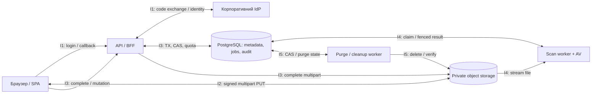

# Resiliency model — стійкість до відмов

[← До вступу та змісту](../FileFlow_SRS.md)

**Обсяг:** CID із **5 логічними взаємодіями** та RMA workbook із **15 сценаріями відмов — по 3 на взаємодію**. CID тут означає *Component Interaction Diagram*, RMA — *Resiliency Model Analysis*: структурований аналіз відмов, наслідків, виявлення та відновлення. Скорочення в умові не розшифровані; це робоча інтерпретація для документа.

Модель уточнює [архітектуру](./04-architecture.md), [обробку помилок](./05-error-handling.md) і [concurrency patterns](./06-concurrency-patterns.md). Усі таймаути й інтервали нижче — початкові налаштування, що підлягають навантажувальній перевірці.

## 1. Цілі та припущення

| Ціль | Значення | Як перевірити |
|---|---|---|
| Доступність API метаданих, NFR-01 | ≥99,5% за календарний місяць | Незалежний probe і помилки API; 0,5% бюджету — 216 хв для 30-денного місяця. |
| Відновлення після втрати VM, NFR-06 | RPO ≤24 год, RTO ≤8 год | Відновити БД **і байти** з recovery set на чистій VM. |
| Цілісність | Немає lost update, дубльованого ефекту або CLEAN без scan | Fault injection на межах транзакцій, worker lease і S3 operations. |
| Відкликання доступу, NFR-10 | Після commit немає нових URL; строк раніше виданих ≤60 с | Race ACL/download і перевірка expiry на фактичному сховищі. |

Одна VM є спільною точкою відмови. Restart policy скорочує простій процесу, але не забезпечує доступність при втраті хоста, диска чи регіону. Заявлені SLO — цілі, а не властивості, автоматично гарантовані Docker Compose.

## 2. CID — модель взаємодій

Кожний I-ID позначає бізнес-взаємодію з кількома технічними викликами. Scan і purge використовують той самий код worker із різними job kinds; окремі блоки потрібні для аналізу, а не для введення мікросервісів.

| ID | Взаємодія й результат | Межа відмови | Профіль часу та повторів |
|---|---|---|---|
| I1 | SSO → серверна сесія | Браузер, BFF, IdP, sessions у БД | Connect 3 с, OIDC HTTP deadline 10 с. Не повторювати обмін одноразового code наосліп; новий login із новими state/nonce. |
| I2 | PUT частин → manifest | Браузер, мережа, storage | До 4 PUT одночасно, 60 с без прогресу, до 3 спроб частини з jitter; PUT URL ≤15 хв. |
| I3 | Complete / mutation → committed version | API, PostgreSQL, storage | DB lock timeout 2 с, statement timeout 5 с; metadata HTTP deadline 30 с. Для storage complete deadline 20 с, потім перевірка фактичного результату. |
| I4 | Claim → checksum/AV → статус | Черга, scan worker, AV, storage | Lease 120 с, heartbeat 30 с, до 3 запусків job. Scan deadline 10 хв із продовженням lease. |
| I5 | Retention → purge → звільнені байти | БД, purge worker, storage | Delete timeout 10 с, до 3 спроб з backoff; після вичерпання FAILED і ручне відновлення. |

DB connection pool обмежений; зовнішні запити не тримають DB-транзакцію відкритою. Виняток — коротка критична секція видачі URL у C3: вона включає локальне підписування й постановку відповіді на відправлення, але не передачу файла. Сервер не може гарантувати час фізичного отримання мережевого пакета клієнтом, лише впорядкування рішення про видачу URL відносно revoke.

## 3. RMA workbook

Оцінка **P1** — загроза цілісності/доступу або повна недоступність, **P2** — деградація окремого потоку зі збереженням даних. Це пріоритет реагування на сценарій, не статистично виміряна ймовірність. Власник I1–I3 — backend, I4–I5 — worker/operations; черговий координує інциденти за [alerting model](./12-monitoring-alerting-model.md).

| RMA / I | Відмова | Наслідок і виявлення | Відновлення / mitigation | Інваріант і fault-injection перевірка |
|---|---|---|---|---|
| R01 / I1 | IdP не відповідає або повертає 5xx, P2 | Новий вхід недоступний; dependency timeout, сплеск login failures | Завершити запит за deadline, показати повторний login. Circuit breaker: 5 технічних відмов за 30 с, пауза 30 с, один пробний запит; чинні сесії діють лише в межах своєї політики перевірки. | Немає локального обходу SSO. Заблокувати IdP мережею й перевірити відмову входу та поведінку наявної сесії. |
| R02 / I1 | Відповідь token exchange втрачена після використання code, P2 | BFF не знає результату, повтор дає invalid_grant | Відкинути незавершений auth flow; нові state/nonce/PKCE і новий вхід. Не повторювати старий code у циклі. | Одна підтверджена сесія або жодної. Обірвати з'єднання після споживання code. |
| R03 / I1 | PostgreSQL падає під час запису сесії, P1 | Cookie не відповідає збереженій сесії; DB error | Cookie видавати тільки після commit. За невідомого результату cookie не видавати; зайва недоступна сесія зникне за TTL. Новий login після відновлення БД. | Неавторизований користувач не потрапляє в API. Убити DB connection до та після commit. |
| R04 / I2 | PUT частини обривається, P2 | Немає підтвердженого ETag, індикатор upload зупинився | Повторити той самий part number і ті самі байти, exponential backoff 1/2/4 с + jitter, максимум 3 спроби. | Частина не дублюється в manifest. Обірвати передачу посередині частини. |
| R05 / I2 | Signed PUT URL прострочений, P2 | Storage повертає 403 expiry; це не JSON Problem від API | Запросити новий URL через API з повторною перевіркою сесії, ACL та upload TTL; повторити частину. Справжню відмову ACL не маскувати retry. | Прострочений upload не поновлюється непомітно. Зсунути час тестового URL та відкликати ACL перед перевидачею. |
| R06 / I2 | Storage повертає 503 або заповнений, P2 | Частини не приймаються, storage error і disk alert | Зменшити паралелізм, обмежити retry, призупинити нові upload. Після expiry виконати abort і звільнити резерв лише за підтвердженого cleanup. | Немає необмеженого зростання orphan-байтів. Емулювати 503 і ENOSPC у тестовому сховищі. |
| R07 / I3 | S3 complete успішний, DB commit не відбувся, P1 | Приватний об'єкт без committed-версії; pending operation у reconciler | Зафіксувати durable operation до зовнішнього виклику. Повтором з тим самим ключем перевірити storage і БД, виконати CAS або передати orphan на cleanup. | Об'єкт не видимий без версії; не видалити об'єкт чинної complete-операції. Зупинити API після S3 success до DB commit. |
| R08 / I3 | Два complete з однаковим expectedVersionNo, P2 | Один commit, інший `409 VERSION_CONFLICT` | CAS і UNIQUE не дають загубити оновлення. Конфліктний об'єкт прибирає worker; клієнту запропонувати окремий файл, не автоматичний overwrite. | Рівно один новий номер. Одночасно завершити дві сесії з бар'єром перед CAS. |
| R09 / I3 | Відповідь 202 загублена після commit, P2 | Клієнт повторює complete, але версія вже існує | Повтор із тим самим Idempotency-Key повертає збережений результат після перевірки прав. Унікальний результат на upload ID захищає і після TTL ключа. | Одна версія, один job, один облік квоти. Втратити HTTP-відповідь і повторити команду 10 разів. |
| R10 / I4 | Worker падає після claim, P2 | RUNNING із простроченим lease, росте вік черги | Після lease expiry job забирає інший worker, збільшує attempts і створює новий lease_token. Не втрачати pending job на restart. | Job залишається в БД. SIGKILL worker одразу після claim, перевірити повторне виконання. |
| R11 / I4 | AV недоступний або завис, P2 | Scan timeout, версія лишається PENDING_SCAN | Bounded retry із backoff, після 3 спроб FAILED і alert. Залишити попередню CLEAN-версію доступною; нову не позначати CLEAN чи malware-REJECTED через технічний timeout. | Fail closed. Зупинити AV, перевірити відсутність download для нової версії й ручний requeue після ремонту. |
| R12 / I4 | Старий worker повернув результат після повторного claim, P1 | UPDATE за старим lease_token змінює 0 рядків | Один TX перевіряє token і PENDING_SCAN, фіксує scan, DONE й унікальну audit-подію. Прострочений власник відкидає результат. | Одноразовий ефект без суперечливих статусів. Призупинити worker A, дати B закінчити, відновити A. |
| R13 / I5 | Purge конкурує з recover або встановленням hold, P1 | CAS одного учасника не проходить; `409` для програного recover/hold | Спільний file row lock. Hold до переходу блокує purge; після PURGING hold/recover не повертають успіх. | ACTIVE або held-файл не видаляється. Перевірити обидва порядки commit з одночасним запуском. |
| R14 / I5 | S3 delete виконався, але відповідь втрачена, P2 | Worker не впевнений у результаті; retry counter | Повторити delete конкретного object key/version ID, перевірити відсутність. Для versioned bucket прибрати фізичні версії, а не лише delete marker. | PURGED тільки після підтвердження всіх об'єктів. Втратити відповідь storage і повторити job. |
| R15 / I5 | Об'єкт видалений, worker впав до DB finalize, P1 | Файл лишається PURGING, quota ще зайнята | Повтор перевіряє відсутність, атомарно записує PURGED, зменшує used_bytes й додає audit за унікальним effect key. | Не відновлювати втрачений файл і не віднімати квоту двічі. SIGKILL між delete та finalize. |

Workbook містить **5 × 3 = 15** різних failure modes. Для кожного тесту майбутній звіт має поля: build SHA, середовище, RMA ID, час ін'єкції, request/job ID, фактичний результат, час відновлення, PASS/FAIL і посилання на логи без секретів. Результати тут не заповнені, оскільки реалізації ще немає.

## 4. Спільні механізми захисту

- **Timeout + bounded retry:** повтори технічних помилок мають максимум, backoff і jitter. `400/403/404/409/422` не повторюються без зміни передумов. `429` дотримується `Retry-After`.
- **Bulkheads:** API connection pool і worker pool мають окремі межі. Початково 2 scan-слоти та 1 purge-слот; великий файл не блокує HTTP-потоки.
- **Backpressure:** за критичного диска або віку черги припинити нові upload, зберегти browse/download існуючих CLEAN-файлів, якщо залежності працюють.
- **Fencing:** lease сам по собі не зупиняє старий процес. Запис результату обов'язково перевіряє поточний lease_token у тій самій транзакції, що й audit.
- **Reconciliation:** кожні 15 хв зіставляти pending complete, uploads, jobs та storage objects. Не виконувати сліпе видалення об'єктів за віком.
- **Graceful shutdown:** перестати приймати jobs, завершити короткі TX, зупинити scan або передати його через lease. Startup readiness перевіряє БД і міграції.

## 5. Disaster recovery і межі SLO

Щодня формувати recovery set: узгоджений PostgreSQL dump, manifest усіх об'єктів, на які він посилається, зашифровані копії цих байтів і версія конфігурації. На час побудови manifest призупинити фізичний purge, щоб потрібні об'єкти не зникли під час копіювання. Нові uploads можна обробляти, але вони не входять до попереднього DB snapshot. Recovery set вважається успішним лише після перевірки повноти й checksum.

Окремий журнал підтверджених purge і revoke експортується поза VM. Перед відкриттям відновленого середовища його застосовують повторно, а всі відновлені вебсесії анулюють. Відновлення застарілої БД не повинно автоматично відновити відкликаний доступ. Якщо журнал недоступний, запуск дозволяється лише після ручного звіряння security admin.

| Крок навчального restore | Бюджет часу |
|---|---|
| Виявлення, рішення про відновлення, нова VM | 1 год |
| Встановлення контейнерів і конфігурації | 1 год |
| Restore PostgreSQL та потрібних об'єктів | 4 год |
| Звіряння видалень/прав, smoke tests, відкриття доступу | 2 год |

Разом — цільові 8 год. Щомісячний restore drill має виміряти фактичний час на обсязі тестових даних; якщо копіювання байтів не вкладається, потрібні інша пропускна здатність або менший RTO-scope, погоджений у SRS. Backup лише PostgreSQL не виконує RPO для файлової системи.

## 6. Джерела та зв'язки

- [PostgreSQL: row locks і SKIP LOCKED](https://www.postgresql.org/docs/current/sql-select.html#SQL-FOR-UPDATE-SHARE) — механізм конкурентного claim.
- [Docker Compose: startup order і health checks](https://docs.docker.com/compose/how-tos/startup-order/) — порядок запуску не замінює обробку runtime-відмов.
- [Модель даних](./07-data-model.md) — retention, квота й атомарні переходи.
- [Deployment model](./10-deployment-model.md) — recovery sets та єдина точка відмови.
