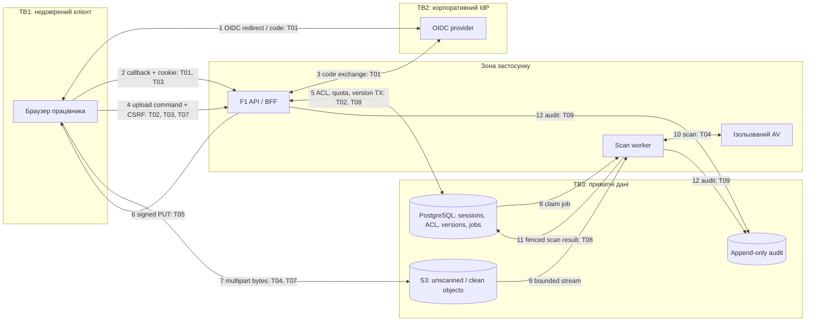
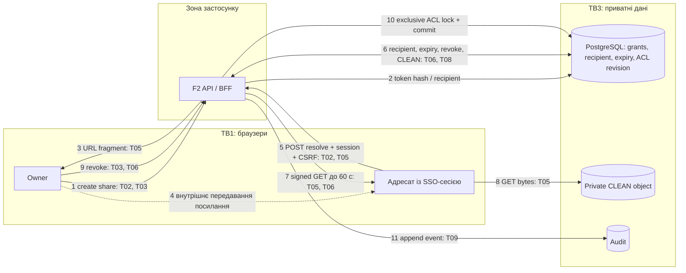

# Security model — модель загроз

[← До вступу та змісту](../FileFlow_SRS.md)

**Обсяг:** threat model для **двох основних потоків** і mitigation plan для **10 пріоритетних загроз**. Аналіз спирається на STRIDE: Spoofing, Tampering, Repudiation, Information Disclosure, Denial of Service, Elevation of Privilege. DFD показують межі довіри, точки входу й сховища; це проєктний аналіз, а не проведений pentest. Методика: [OWASP Threat Modeling](https://cheatsheetseries.owasp.org/cheatsheets/Threat_Modeling_Cheat_Sheet.html).

## 1. Активи, ролі та межі довіри

| Актив / межа | Що захищаємо | Довірчі припущення |
|---|---|---|
| Файлові байти й історія версій | Конфіденційність, цілісність, можливість відновлення | Власник простору керує доступом, але не може обійти scan або hold. |
| PostgreSQL metadata, ACL, jobs | Правильність зв'язків, квоти, статусів і авторизації | Лише API/worker через обмежені DB-ролі; браузер не має SQL-доступу. |
| Сесія, OIDC state, share token, signed URL | Неможливість підробити користувача чи грант | Усі ці значення є секретами, навіть якщо мають короткий строк дії. |
| Audit та backup | Доказ дій і відновлюваність | API не може переписувати audit або видаляти зовнішні backup. |
| TB1: браузер → public HTTPS endpoint | Недовірені параметри, файли, cookies | Валідація й авторизація на сервері для кожного запиту. |
| TB2: API → IdP / storage | Зовнішня залежність і серверна ідентичність | Перевірений TLS, фіксовані endpoints, мінімальні service credentials. |
| TB3: застосунок → data network | Доступ до БД, object store та AV | Розділені контейнерні мережі й service roles. Спільний host root усе ще має широкий доступ. |
| TB4: VM → зовнішній backup / monitoring | Друга адміністративна зона | Окремі credentials, retention і доступ оператора. |

Security admin може керувати політиками та hold, але не отримує права читати всі файли. Root-адміністратор VM — інша, привілейована інфраструктурна роль; файлові ACL застосунку не захищають від скомпрометованого host root. Для dev використовуються лише синтетичні дані.

## 2. Потік F1: вхід, upload і перевірка файла

**Передумови:** активний корпоративний користувач, роль EDITOR/OWNER, чинна сесія та квота. **Результат:** нова версія проходить `PENDING_SCAN → CLEAN/REJECTED`; тільки CLEAN допускається до завантаження. `complete` не означає, що файл уже безпечний.

Unscanned і clean на діаграмі — логічні стани одного приватного сховища. Дозвіл GET створюється лише API після перевірки статусу. Клієнт не обирає довільний object key, bucket або scan status.

## 3. Потік F2: внутрішнє поширення, download і revoke

**Передумови:** share-link створено OWNER для конкретного корпоративного `recipientUserId`; TTL 1–168 год. **Результат:** `resolve` перевіряє не лише токен, а й особу, expiry/revoke, стан файла та найновішу CLEAN-версію. Для share-link застосовується окремий адресний грант; незалежний workspace/ACL-доступ може залишитися після його revoke.

Прямий `GET /files/{fileId}/download-link` проходить таку саму перевірку стану, але використовує workspace/ACL, а не share token. Групові зміни, file permissions і revoke share-link використовують спільні ворота авторизації workspace, щоб нова видача URL не обігнала commit відкликання.

## 4. Реєстр загроз і mitigation plan

Оцінки **L** (ймовірність) та **I** (вплив) від 1 до 3 — експертні, а не результати вимірювань. Ризик `L × I`: 9 — критичний, 6 — високий. Таблиця містить десять найпріоритетніших загроз цієї моделі. P0-контроль потрібен до будь-якого shared demo, P1 — до використання реальних корпоративних даних.

| ID / потік / STRIDE | Загроза та сценарій | L×I | Mitigation / пріоритет | Власник і перевірка | Залишковий ризик |
|---|---|---|---|---|---|
| T01 / F1 / S,E | Підроблений callback, replay code, ID token іншого issuer або account confusion | 3×3=9 | P0: OIDC Code + PKCE, одноразові state/nonce з TTL 5 хв, точний redirect URI, перевірки iss/aud/exp/signature, дозволений issuer. Ключ особи — issuer+sub. | Backend: повтор callback, чужий aud, прострочений nonce мають завершитися без сесії. | Компрометація IdP лишається зовнішнім ризиком; MFA задається його політикою. |
| T02 / F1,F2 / E,I | IDOR: заміна fileId/workspaceId/recipientUserId для читання чужих даних чи видачі гранту | 3×3=9 | P0: server-side authorization кожної операції, перевірка зв'язків ресурсів, recipient із сесії, відсутність admin-bypass, параметризований SQL. | Backend: матриця VIEWER/EDITOR/OWNER/SECURITY_ADMIN і два чужі простори, включно з search та versions. | Помилка нового endpoint; потрібні тести авторизації для кожної операції. |
| T03 / F1,F2 / S,T | CSRF або stored XSS через назву файла запускає дії від імені жертви | 3×3=9 | P0: HttpOnly/Secure/SameSite cookie, CSRF на мутаціях, escape тексту, CSP, відсутність HTML-preview недовірених файлів. Downloads — attachment із безпечними headers. | Frontend/backend: чужий Origin і відсутній CSRF відхиляються; назва з HTML не виконує JS. | XSS може діяти в контексті сесії навіть із HttpOnly; потрібне оновлення залежностей. |
| T04 / F1 / T,D,E | Malware, archive bomb або експлойт сканера через завантажений файл | 3×3=9 | P0: карантин до CLEAN, checksum, актуальні AV signatures, ліміти CPU/RAM/часу/розпакування, AV без зовнішньої мережі та без storage credentials. | Worker: безпечний AV test fixture і контрольований archive-limit test у dev; timeout не дає CLEAN. | Антивірус не гарантує виявлення невідомого malware; небезпечний вміст не виконується сервером. |
| T05 / F1,F2 / I,S | Витік share token або signed URL через лог, referrer, браузерну історію чи сторонній скрипт | 3×3=9 | P0: token у fragment і POST body, прибрати fragment через history API, Referrer-Policy no-referrer, no-store, без сторонньої аналітики на share page, редагування логів, hash у БД, GET TTL ≤60 с. | Backend/frontend/operations: перевірити access logs, error traces і response cache на секрети; URL не дає bucket listing. | Скопійований чинний signed URL — bearer capability до expiry; збережену користувачем копію відкликати неможливо. |
| T06 / F2 / T,E | TOCTOU: URL виданий після revoke або доступ залишився через застарілу проєкцію груп | 2×3=6 | P0: спільний ACL row lock, повторна перевірка під lock, без позитивного міжзапитного кешу. Для IdP-проєкції — revalidation до 5 хв; якщо свіжість не підтверджено, нові гранти/URL не видавати. | Backend: конкурентний revoke/download, видалення групи та окремого персонального гранту. | URL, виданий раніше, діє до expiry; inherited grant може незалежно дозволяти доступ. |
| T07 / F1 / D | Вичерпання диска, квоти чи worker slots багатьма multipart-сесіями | 3×3=9 | P0: файл ≤2 GiB, 4 PUT на клієнта, 20 активних upload глобально як початковий ліміт, атомарні резерви квоти, REST rate limit 120/хв, abort expiry, backpressure за диском. | Backend/operations: паралельні uploads на межі квоти, cleanup orphan, припинення upload до ENOSPC. | Розподілений flood може потребувати лімітів провайдера; підписані PUT мають власні обмеження storage. |
| T08 / F1,F2 / T,E | Застарілий worker або клієнт підміняє scan status, version pointer чи purge state | 2×3=6 | P0: клієнт не задає status/object_key, CAS, UNIQUE, fenced worker update, окремі DB-ролі, immutable bytes, lock hold/purge. | Backend/worker: C2/C4/C5, спроба write в закриті поля, stale lease result змінює 0 рядків. | Компрометований worker із чинним доступом до запису потребує ізоляції та ротації ключів. |
| T09 / F1,F2 / R,T | Видалення чи підробка аудиту приховує зміну прав або скачування | 2×3=6 | P1: audit mutation в одному TX з доменною зміною, append-only роль, унікальний effect key, зовнішній export із checksum та окремим delete-доступом. | Operations/security admin: API-role не може UPDATE/DELETE, відсутність audit зупиняє критичну мутацію, export перевіряється при restore. | Host/DB superuser може змінити локальний журнал; checksum без незалежної копії цього не запобігає. |
| T10 / обидва потоки, інфраструктура / I,E,T | Публічний bucket/DB, credential у Git або backup, захоплення VM | 3×3=9 | P0: private bucket, default-deny ingress, SSH keys, DB/AV не публікуються, секрети поза Git, service roles без зайвих delete/admin прав. P1: зашифрований зовнішній backup і регулярні оновлення host/images. | Operations: зовнішній port scan власної VM, anonymous GET denied, secret scan репозиторію, restore з окремими ключами. | Одна VM не ізолює дані від host root; реальні дані потребують посиленого операційного контролю. |

## 5. Послідовність впровадження

1. **До першого командного demo:** T01–T08 і базові T10; синтетичні файли, приватне сховище, SSO/ACL/CSRF, quarantine, квоти й секрети поза репозиторієм.
2. **До реальних даних:** повний T09/T10, backup restore, ротація секретів, перевірка конфігурації та огляд залежностей. Власники перевіряють кожний рядок таблиці з посиланням на test evidence.
3. **Після зміни trust boundary:** оновити DFD і threat register при додаванні зовнішніх адресатів, desktop sync, нового storage/IdP або окремої VM.

## 6. Межі гарантій та реагування

Для S3 строк signed URL перевіряється на початку запиту; завантаження, розпочате до expiry, може тривати після нього. Отже, 60 с у NFR-10 обмежують можливість почати новий GET, а не тривалість уже відкритого потоку. Вимога миттєво розірвати передачу потребувала б download proxy та зміни архітектури. [AWS: presigned URL expiration](https://docs.aws.amazon.com/AmazonS3/latest/userguide/using-presigned-url.html).

У разі витоку: відкликати сесії/гранти, обмежити видачу нових URL, ротувати скомпрометовані service credentials, зберегти audit evidence і перевірити охоплені об'єкти. Не видаляти журнали або байти для «приховування» інциденту. Модель зберігання evidence і строків наведена в [data model](./07-data-model.md), відповідальні та сповіщення — у [monitoring model](./12-monitoring-alerting-model.md).
