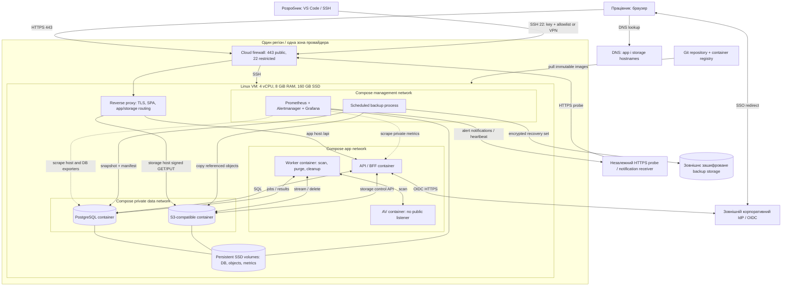

# Deployment model — модель розгортання

[← До вступу та змісту](../FileFlow_SRS.md)

**Призначення:** інфраструктурна діаграма, типи ресурсів, мережа, диски, конфігурація, випуск і відновлення FileFlow. Основний профіль — **одна Linux VM із Docker Compose для розробки та демонстрації**. Ресурси й процедури нижче є планом; VM, Dockerfiles, compose-файл і pipeline ще не створені.

## 1. Топологія

Прямокутники — обчислювальні ресурси/процеси, циліндри — персистентні дані, вкладені області — адміністративні та мережеві межі. Суцільні стрілки — робочий трафік, пунктир — спостережуваність. HTTPS до storage проходить через reverse proxy, **але не через API/BFF**; proxy не буферизує весь файл на диску.

Для навчальної VM object storage може працювати контейнером. Це уточнення dev-профілю [базової архітектури](./04-architecture.md), де S3 розглядався як окремий сервіс. Для корпоративного середовища доцільно винести storage за межі VM і використовувати корпоративний IdP. Локальний dev-IdP з тестовими користувачами можна додати окремим Compose profile; він не підміняє корпоративну ідентичність у production.

## 2. Каталог ресурсів

| Ресурс / тип | Призначення | Персистентність / конфігурація | Відмова |
|---|---|---|---|
| Linux VM, x86-64 compute | Docker Engine, мережі й контейнери | 4 vCPU, 8 GiB RAM як старт; 16 GiB для більшого запасу | Втрата VM зупиняє всі локальні сервіси. |
| SSD block volume | Images, DB, файлові байти, логи й метрики | Орієнтир 160 GB; named volumes не лежать у writable layer контейнера | Один диск — спільний failure domain; snapshot не замінює off-host backup. |
| DNS + reverse proxy | TLS termination, SPA, `/api/v1`, storage endpoint | Два hostnames, сертифікати з автоматичним поновленням | Probe перевіряє HTTPS і expiry, proxy readiness перевіряє маршрути. |
| API/BFF, один container | Метадані, ACL, OIDC, signed URLs | Stateless process, sessions у PostgreSQL | Restart відновлює процес; незавершені зовнішні операції обробляє reconciliation. |
| Worker, один container | 2 scan-слоти, 1 purge-слот, cleanup | Jobs/leases у PostgreSQL, тимчасові файли з обмеженням | Restart не губить jobs; stale lease захищений fencing token. |
| PostgreSQL, database container | Єдиний транзакційний контур | Named volume, міграції, окремі ролі API/worker/backup | Автоматичного failover немає; відновлення з recovery set. |
| S3-compatible object service | Приватні байти, multipart, signed GET/PUT | Named volume, bucket policy, lifecycle незавершених uploads | Недоступні передачі байтів; метадані можуть залишатися доступними. |
| AV service | Потокова перевірка недовірених файлів | Signatures cache, регулярне оновлення, обмежений temp disk | Нові версії залишаються PENDING_SCAN, ніколи не CLEAN за timeout. |
| Identity provider | SSO й корпоративний каталог | Зовнішній корпоративний сервіс; dev profile із тестовим realm | Нові входи зупиняються; діє політика свіжості наявних сесій. |
| Metrics stack | Prometheus, Alertmanager, Grafana й exporters | Private ports, metrics retention 30 днів із лімітом диска | Зовнішній heartbeat/probe виявляє втрату самої системи моніторингу. |
| Backup destination, external storage | Recovery sets на 30 днів | Окремий обліковий запис/credentials, шифрування | Невдалий або прострочений backup викликає alert. |
| Registry і Git | Код, образи, release manifests | Immutable tag/digest, секрети не комітяться | Вже запущені сервіси працюють, новий deploy відкладається. |

## 3. Бюджет однієї dev-VM

Нижче — стартовий план лімітів для 8 GiB RAM, не виміряний профіль навантаження. Контроль одночасних scan/build потрібен навіть якщо сума номінальних лімітів вкладається в RAM.

| Споживач | Орієнтир RAM |
|---|---:|
| OS, Docker, proxy | 0,75 GiB |
| API | 0,75 GiB |
| Worker | 0,75 GiB |
| PostgreSQL | 1,00 GiB |
| Object storage | 0,75 GiB |
| AV і signatures | 1,50 GiB |
| Metrics stack | 0,75 GiB |
| Залишок для піків / build | 1,75 GiB |

Локальний IdP і frontend dev server зменшують цей залишок. Важкі збірки краще виконувати в CI або послідовно з обмеженням паралелізму; за OOM чи стійкого тиску пам'яті VM збільшується до 16 GiB. Навантажувальний генератор варто запускати поза тестованою VM, щоб він не спотворював результати.

Для диска 160 GB орієнтовно виділити: 20 GB OS/інструменти, 20 GB images/build cache, 15 GB PostgreSQL, 60 GB об'єкти, 10 GB метрики/логи, 10 GB temp/staging і 25 GB резерв. Файлові квоти просторів у dev сумарно не перевищують бюджет об'єктів. Temp space потрібен для scan, backup streaming і upload cleanup; повна локальна копія всього backup не створюється. Спостерігаємо як вільні байти, так і inode.

Цього профілю очікувано достатньо для розробки й малої демонстрації. Підтримка 200 працівників, 50 активних користувачів і 20 uploads зі SRS потребує окремого вимірювання.

## 4. Мережа, порти та секрети

| Звідки → куди | Доступ | Правило |
|---|---|---|
| Internet → proxy | TCP 443, за потреби 80 для redirect/ACME | Тільки app/storage hostnames; TLS 1.2+, CORS storage лише для SPA origin. |
| Developer → SSH | TCP 22 | Ключ, allowlist або VPN. Адмінські dashboards — через SSH tunnel/VPN. |
| Proxy → API / S3 | Приватні порти контейнерів | Host headers і canonical URL зберігаються для перевірки підпису S3; час синхронізований. |
| API/worker → PostgreSQL | TCP 5432 у data network | Немає public port mapping; окремі DB-ролі й connection pools. |
| Worker → AV | Приватний scanner port | Не публікується на host; AV не має DB чи S3 admin credentials. |
| API → IdP, VM → registry/update endpoints | Вихідний HTTPS | Список потрібних залежностей, без довільного fetch URL від користувача. |
| Monitoring → metrics/exporters | Приватні management ports | `/metrics` не маршрутизується у public proxy. Grafana/Prometheus не доступні анонімно. |
| Backup → зовнішнє storage | Вихідний HTTPS | Окремий ключ із мінімальними правами, окремі credentials для restore і видалення backup. |

TLS URL storage має бути доступним браузеру: внутрішній hostname контейнера у signed URL не працює. Перевірка на іншому комп'ютері обов'язкова. API підписує конкретні method/key/part, bucket лишається приватним, адміністративна консоль storage не публікується.

Секрети зберігаються у файлах поза Git із обмеженими правами та монтуються read-only через Compose secrets або надаються менеджером секретів. Compose secrets самі по собі не шифрують диск хоста. Репозиторій має містити лише `.env.example` з іменами змінних. Контейнери не отримують Docker socket, не запускаються privileged, використовують non-root user там, де образ це підтримує.

## 5. Шлях від коду до release

1. У feature branch виконати unit/integration тести, API contract check, перевірку залежностей і secret scan.
2. Зібрати API/worker із одного commit, SPA — з того самого release; опублікувати образи за digest. Не використовувати mutable `latest` як ідентифікатор релізу.
3. Записати release manifest: Git SHA, digests, версія schema, конфігурація без секретів, посилання на успішний recovery set.
4. Перед міграцією перевірити свіжість backup та вільний диск. Виконати backward-compatible міграцію окремим одноразовим контейнером, а не конкурентно у кожному API/worker.
5. Оновити сервіси, дочекатися DB health, schema readiness і API readiness. `depends_on` із health condition допомагає під час запуску, але застосунок усе одно має переживати подальші розриви залежностей. [Docker Compose startup order](https://docs.docker.com/compose/how-tos/startup-order/).
6. Виконати smoke flow: SSO → upload невеликого тестового файла → CLEAN → download checksum → share потрібному адресату → revoke → новий resolve denied.
7. За регресії повернути попередні image digests. Schema rollback допускається лише якщо міграція оборотна й перевірена; інакше forward fix або контрольований restore. Повернення старого image не скасовує автоматично міграцію БД.

У dev-VM припустиме коротке maintenance window. Тут не обіцяється zero-downtime deployment. Перевірки NFR та RMA виконуються після змін, які впливають на відповідні гарантії.

## 6. Персистентність, backup і відновлення

- Restart/recreate контейнера не видаляє named volumes. Команди на кшталт `down -v` не є штатним способом оновлення середовища з даними.
- Добовий recovery set містить DB snapshot, manifest і копії всіх referenced objects, конфігурацію та потрібні ключі через окремий захищений канал. Не копіювати «живу» PG data directory без узгодженого механізму backup.
- Backup завершений тільки коли скопійовано й перевірено всі частини. Якщо копіювання починається раз на 24 год і триває довго, сам розклад ще не гарантує RPO ≤24 год: контролюється вік останньої відновлюваної точки, а частота збільшується за потреби.
- Щомісяця відновлювати на чистому середовищі, звіряти checksum вибірки та наявність **усіх** об'єктів із manifest, повторно застосовувати журнал purge/revoke, анулювати старі сесії.
- RPO ≤24 год і RTO ≤8 год беруться з SRS; процедура та бюджет часу — у [resiliency model](./08-resiliency-model.md).

## 7. Відповідність завданню та межі

Діаграма показує compute, network boundaries, firewall, DNS/TLS, persistent storage, зовнішні залежності, backup і monitoring з поясненнями типів ресурсів. Наведений в умові [приклад Gliffy](https://www.gliffy.com/sites/default/files/image/2021-08/image-hub-cloud-architecture-aws.jpg) повернув HTTP 404 під час підготовки; його графіку не копійовано. Побудовано власну інфраструктурну модель FileFlow без прив'язки до AWS.

За переходу до production першими кандидатами на винесення є object storage, PostgreSQL і незалежний monitoring. Це окремий етап, а не обов'язкова умова навчального MVP. [Security model](./09-security-model.md) описує доступ і загрози, [monitoring model](./12-monitoring-alerting-model.md) — контроль ресурсів та сповіщення.
