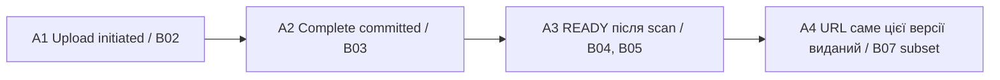
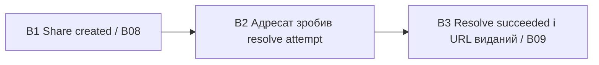

# Analytics model — продуктова аналітика

[← До вступу та змісту](../FileFlow_SRS.md)

**Обсяг:** **12 функціональних метрик** із формулами, вимірами, джерелами та FR-зв'язками, а також **дві воронки**. Мета — оцінити, чи працівники можуть зберігати, знаходити й поширювати файли. CPU, latency API та черги належать до [операційного моніторингу](./12-monitoring-alerting-model.md).

Метрики, події й dashboard-и нижче є проєктом інструментування. Виміряних значень поки немає; `N/A` означає відсутній знаменник або недоступні дані, а не нульову конверсію.

## 1. Модель подій і збір

### 1.1. Контракт аналітичної події

| Поле | Значення / обмеження |
|---|---|
| `eventId`, `eventName`, `schemaVersion` | Стабільний UUID події, назва з allowlist, версія схеми. Повтор доставки не створює новий ID. |
| `occurredAt`, `receivedAt` | Серверний час факту та час надходження в проєкцію, UTC. |
| `actorKey` | Псевдонім користувача для distinct counts; mapping доступний лише обмеженій сервісній ролі. Це не анонімні дані. |
| `workspaceId` | Вимір доступу й агрегації, не public Prometheus label. |
| `uploadId`, `fileId`, `versionNo`, `shareLinkId`, `operationId` | Лише релевантні кореляційні ID. `operationId` стабільний для повторів однієї бізнес-команди; `requestId` може змінюватися на кожній HTTP-спробі. |
| `result`, `reasonCode`, `role`, `sizeBucket` | Обмежені enum. Розмір групується як ≤1 MiB, 1–10 MiB, 10–100 MiB, 100 MiB–2 GiB. |
| `source`, `environment`, `isSynthetic` | `API/WORKER/PROJECTION`, dev/demo/prod, відокремлення тестового трафіку. |

Не збираємо email, ім'я, IP для продуктової аналітики, назву чи вміст файла, текст пошуку, cookie, токени, повний URL або object key. `actorKey` і ресурсні ID видаляються разом із сирими подіями через 30 днів. Добові агрегати живуть 180 днів за [retention policy](./07-data-model.md).

### 1.2. Джерела та доставка

| Події | Джерело факту | Дедуплікація |
|---|---|---|
| `upload.initiated`, `upload.complete_committed`, `version.restored`, `file.recovered`, `share.created` | Успішний domain TX і відповідна audit-подія | Стабільний ID доменної події, не кількість HTTP-відповідей. |
| `upload.ready`, `upload.rejected` | Fenced scan-result TX worker | Одна кінцева подія на upload/version; повторний job не додає нової. |
| `download.link_issued`, `share.resolve_succeeded` | Сервер успішно авторизував і сформував відповідь із URL | Кореляційний ID видачі; повторна нова видача URL є новою подією. |
| `share.resolve_attempted`, `search.executed`, `version.complete_attempted`, `file.recover_attempted`, `activity.authorized` | Server instrumentation після перевірки сесії; результат формується після завершення запиту | Attempt/operation ID згідно з метрикою; retries одного complete/recover об'єднуються. |

Mutation-факти витягуються з аудиту й доменних станів. Події читання записуються в окрему обмежену аналітичну проєкцію в тій самій PostgreSQL, без Kafka чи нового публічного endpoint. Аналітичні таблиці є службовими проєкціями поверх [основної ER-моделі](./07-data-model.md), а не джерелом прав або файлових станів.

Worker оновлює проєкції кожні 5 хв, пакетами до 500 подій. Для mutation events використовує durable ознаку обробки/окрему таблицю receipt з `UNIQUE(eventId)`, а не лише `MAX(id)` як checkpoint: пізній commit не повинен загубитися через неупорядковані UUID або транзакції. Агрегат і receipt фіксуються в одному TX. Події читання можуть тимчасово буферизуватися; переповнення враховується в `analytics_events_dropped_total`, а dashboard позначає неповноту даних.

Аналітичний збій не блокує browse/search і не змінює ACL. Обов'язковий аудит критичних мутацій зберігає свої сильніші гарантії. Запізнілі події перераховують добові агрегати за останні 7 днів; довші backfill запускаються явно й позначаються в dashboard. Повтори ingest не збільшують counts.

## 2. Каталог функціональних метрик

Для добових агрегатів доба визначається в `Europe/Kyiv`, зберігання часу — UTC. Test users і synthetic probes виключаються за `isSynthetic`. Когортні конверсії обчислюються лише після завершення вікна спостереження.

| ID / метрика | Визначення, одиниця та вікно | Виміри | Подія / спосіб збору | Зв'язок із вимогами / рішення |
|---|---|---|---|---|
| B01 Активні працівники | DAU = distinct actorKey із хоча б однією успішною дозволеною дією за добу; людей. WAU — distinct за 7 днів, не сума DAU. | День, workspace, роль | `activity.authorized` для browse/search/upload/share/download-link, без фонового polling `/me` | FR-01, FR-02: чи використовують доступні простори. |
| B02 Розпочаті uploads | Кількість унікальних uploadId із `upload.initiated` за добу | Workspace, new file/new version, sizeBucket | Domain TX створення upload | FR-04: попит і стартовий обсяг воронки A. |
| B03 Конверсія complete | Uploads когорти B02 із `complete_committed` не пізніше 24 год / усі B02 цієї когорти ×100% | Дата старту, workspace, sizeBucket | Join `upload.initiated → upload.complete_committed` за uploadId | FR-04: частка передач, що дійшла до committed-версії. |
| B04 Конверсія READY | Uploads когорти B02 із READY протягом 24 год / усі B02 ×100% | Дата старту, workspace, sizeBucket, failure reason окремо | `upload.ready`, `upload.rejected`; READY лише після CLEAN | FR-06: кінцева придатність upload, не лише отримання байтів. |
| B05 Час до READY | p50/p95 `readyAt − initiatedAt`, секунди, для READY у межах 24 год | День завершення, sizeBucket, new/new version | Timestamps B02 і READY за uploadId | FR-04, FR-06: тривалість користувацького шляху. Невдалі upload враховуються в B04, а не приховуються latency. |
| B06 Відновлені попередні версії | Кількість унікальних успішних restore operationId за добу | Workspace, роль | `version.restored`, створений новий versionNo | FR-08: використання історії, дубль Idempotency-Key не рахується двічі. |
| B07 Видані download links | Кількість успішних видач signed GET за добу | Workspace, direct/share, роль | `download.link_issued`, включно з успішним share resolve | FR-07, FR-10: дозволений доступ. Це **не** кількість завершених скачувань. |
| B08 Створені внутрішні посилання | Кількість унікальних shareLinkId за добу | Workspace, TTL bucket: ≤24 год / >24 год | `share.created` | FR-10: початок воронки B. |
| B09 Конверсія адресного поширення | Посилання когорти B08 із хоча б одним успішним resolve адресатом до expiry / усі B08 ×100% | День створення, workspace, TTL bucket | Join `share.created → share.resolve_succeeded` за shareLinkId | FR-10: чи дійшов адресат до дозволеного доступу. Чекати expiry, максимум 168 год. |
| B10 Частка пошуку без результатів | Успішні search із resultCount=0 / усі успішні search ×100%, доба | Workspace, роль | `search.executed` з resultCountBucket, без query text | FR-11: сигнал проблем знаходження. Порожній результат після ACL-фільтрації може бути правильним. |
| B11 Конфлікти версій | Унікальні complete operationId для existing file з `VERSION_CONFLICT` / усі завершені успіхом або остаточною помилкою такі operationId ×100%, доба | Workspace, reasonCode | `version.complete_attempted` + кінцевий outcome, не transport retry | FR-05, NFR-08: частота конкурентного редагування. Конфлікт свідчить про захист, а не автоматично про дефект. |
| B12 Успішність recover із кошика | Унікальні успішні recover operationId / усі завершені recover operationId ×100%, доба | Workspace, outcome: recovered/purging/expired/denied | `file.recover_attempted`, `file.recovered` | FR-12, FR-15: користь кошика та причини відмов. |

## 3. Воронка A — від upload до доступного файла

**Одиниця аналізу:** `uploadId`, а не користувач чи HTTP request. **Когорта:** усі uploads, ініційовані в обрану добу. **Вікно:** 24 год від initiatedAt; поточна незріла когорта позначається provisional.

| Крок | Подія і умова | Метрика / конверсія | Як інтерпретувати втрату |
|---|---|---|---|
| A1 | Один `upload.initiated` | N1 = B02 | Базовий знаменник. |
| A2 | `complete_committed` для того самого uploadId у вікні | N2/N1 = B03 | Перерване передавання, expiry, quota або version conflict. |
| A3 | READY після A2, у тому самому вікні | N3/N1 = B04; N3/N2 — scan conversion, час B05 | REJECTED — безпековий результат; pending/FAILED — технічна затримка. Показувати окремо. |
| A4 | Перша `download.link_issued` із відповідними fileId/versionNo після A3 | N4/N3; end-to-end N4/N1 | Користувач міг лише зберегти файл, тому відсутність скачування не завжди є проблемою. |

Повтор complete з тим самим ключем не створює новий крок. Для download до попередньої CLEAN-версії, поки нова pending, A4 нової версії не зараховується. Доказ завершеної передачі байтів у цю воронку не входить, бо API спостерігає видачу URL, а не завершення прямого GET у браузері.

## 4. Воронка B — від share-link до доступу адресата

**Одиниця аналізу:** `shareLinkId`. **Когорта:** посилання, створені в обрану добу. **Вікно:** від createdAt до expiresAt, не довше 168 год; revoke закриває можливість подальшої конверсії, але не прибирає посилання зі знаменника.

| Крок | Подія і умова | Метрика / конверсія | Причина втрати |
|---|---|---|---|
| B1 | Унікальний `share.created` з TTL і адресатом | M1 = B08 | База воронки. |
| B2 | Перший `resolve_attempted`, токен зіставлений із shareLinkId, actor є адресатом, час до expiry | M2/M1 | Посилання не передали, адресат не відкрив або не завершив SSO. Ці причини без додаткових подій не розрізняємо. |
| B3 | Перший `resolve_succeeded` після B2, до expiry і revoke, з виданим URL | M3/M2; M3/M1 = B09 | Revoke, TRASHED/PURGING, відсутня CLEAN-версія або технічна відмова. |

Неправильні/невідомі токени не зберігаються в аналітиці та не додаються до B2; їхні знеособлені security counts ідуть в операційний моніторинг. Неправильний адресат теж не просуває воронку. Повторні успішні resolve додають видачі в B07, але не збільшують M3. Це не вимір фактичної доставки повідомлення чи прочитання документа.

## 5. Dashboard і якість даних

Owner бачить лише власні workspace-агрегати; аналітична роль не дає доступу до байтів. Загальний dashboard доступний уповноваженому адміністратору за окремим дозволом. Показуємо дату останнього оновлення, розмір вибірки, provisional/complete cohort і факт пропущених подій. Розрізи з менш ніж 5 різними людьми приховуємо від загальнокомандного dashboard; внутрішні технічні лічильники залишаються для перевірки.

Оновлення — кожні 5 хв, огляд продуктових тенденцій — щотижня. Немає автоматичного оцінювання продуктивності працівників за кількістю upload/download. Основні рішення: де губляться uploads, чи працює поширення, чи знаходять люди дозволені файли, чи потрібні кращі UX-пояснення конфліктів.

### Перевірки приймання

1. Replay одного mutation event 10 разів дає один факт у проєкції; повторне агрегування не змінює підсумок.
2. Подія пізнього commit потрапляє в проєкцію; delivery order не змінює порядок кроків, який визначається occurredAt і доменними передумовами.
3. На синтетичній upload-когорті з N1=10, N2=8, N3=6, N4=3 очікуємо B03=80%, B04=60%, A4/A3=50%. Це тестові дані, не реальні результати.
4. Для M1=5, M2=4, M3=3 після expiry всієї когорти B09=60%; revoke одного неконвертованого посилання не зменшує M1.
5. Пошук без результатів не записує пошуковий рядок; токен із share URL відсутній у будь-якій події.
6. Owner одного простору не бачить чужу аналітику; видалення сирих подій за TTL не залишає actorKey у довготривалих агрегатах.
