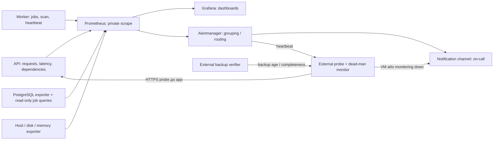

# Monitoring & alerting model — моніторинг і сповіщення

[← До вступу та змісту](../FileFlow_SRS.md)

**Обсяг:** **15 операційних метрик**, спосіб їх збору та зв'язок з інфраструктурою; **10 правил alerting** із нормальними діапазонами, warning/critical thresholds і mitigation plan. Значення — початкові проєктні пороги, а не результати вимірювань чи гарантії провайдера.

## 1. Схема спостережуваності



Prometheus, Alertmanager і Grafana можуть працювати на dev-VM. Зовнішній probe, перевірка backup і dead-man receiver мають бути **поза цією VM**, інакше її вимкнення одночасно вимкне всі засоби виявлення. Це може бути невеликий незалежний сервіс; його налаштування ще не виконане.

Scrape API/worker/host — кожні 15 с, DB exporter — 30 с, зовнішній HTTPS probe — 60 с, оцінка правил — 30 с. Метрики зберігаються 30 днів із лімітом диска, логи — 14 днів. Dashboard доступний через VPN/SSH tunnel, `/metrics` не публікується через зовнішній proxy.

## 2. Каталог операційних метрик

Metric names нижче — запропонований контракт інструментування. Counter ніколи не зменшується в межах процесу; для вікон використовується `rate`/`increase`, а не різниця сирих значень через restart. Histogram збирає розподіл, gauge — поточний стан або timestamp.

| ID / назва | Формула / одиниця | Виміри | Ресурс і спосіб збору | Зв'язок |
|---|---|---|---|---|
| O01 API availability | Успішні планові HTTPS probes / усі заплановані probes ×100% за календарний місяць; пропуски не вважаються успіхом | environment, probe_region, check | Незалежний probe endpoint readiness через proxy, який перевіряє API і легкий DB read | NFR-01, proxy/API/PG |
| O02 Metadata latency p95 | p95 histogram `fileflow_http_request_duration_seconds`, секунди за 5 хв | route template, method, environment | Middleware API вимірює весь час browse/search, включно з DB; не файлові PUT/GET | NFR-02 |
| O03 API 5xx ratio | rate 5xx / rate всіх API responses ×100% за 5 хв | service, route group, environment | `fileflow_http_requests_total{status_class}` в API; proxy 502/504 додаються окремим edge counter без подвійного підрахунку | NFR-01, R03/R07 |
| O04 Dependency failure ratio | Timeout/5xx/transport failures / усі виклики залежності ×100% за 5 хв | dependency=oidc/storage/av, operation, environment | `fileflow_dependency_requests_total{result}` у service adapters; 403 expiry не вважається інфраструктурним failure | R01/R06/R11 |
| O05 Oldest unfinished job age | `now − min(created_at)` серед QUEUED/RUNNING потрібного kind, секунди; 0 лише якщо запит успішний і черга порожня | job_kind, environment | Read-only query по PostgreSQL кожні 30 с, `fileflow_jobs_oldest_unfinished_age_seconds` | R10/R11, worker backlog |
| O06 Нові FAILED jobs | `increase(fileflow_jobs_failed_total[15m])`, кількість terminal failures | job_kind, reason_code, environment | Counter переходів у FAILED + persisted reconciliation для restart | R10–R15 |
| O07 Scan duration p95 | p95 `fileflow_scan_duration_seconds` за 15 хв, включно з timeout observations | outcome=clean/rejected/technical_failure, size_bucket | Worker histogram від початку scan до його результату, без очікування в черзі | FR-06, R11 |
| O08 CPU busy | `100 × (1 − avg(rate(node_cpu_seconds_total{mode="idle"}[5m])))`, % по vCPU | instance, environment | Host exporter; container CPU для drill-down, не окрема бізнес-метрика | VM, NFR-02/03 |
| O09 Memory pressure | `100 × (1 − MemAvailable / MemTotal)`, % | instance, environment | Host exporter, container working set і OOM events у логах для діагностики | VM/API/AV/PG |
| O10 Disk/inode utilization | `100 × (1 − available/total)`, %, окремо для bytes та inodes | filesystem, resource=bytes/inodes, environment | Host exporter для persistent/temp mounts, без proc/sys і псевдо-FS | PG/S3/logs/temp, R06 |
| O11 DB connection utilization | Відкриті прикладні connections / доступний прикладний бюджет ×100% | database, application=api/worker, environment | PG exporter / pg_stat_activity; бюджет виключає зарезервовані admin connections | PostgreSQL, R03 |
| O12 Найдовше очікування DB lock | max віку активного запиту з `wait_event_type=Lock`, секунди | database, application, environment | Обмежений read-only pg_stat_activity query, без текстів SQL і параметрів | CAS/ACL/quota, R08/R13 |
| O13 Recovery point age | `now − snapshot_time` останнього **повністю перевіреного** recovery set, години | environment, backup_set_type | Зовнішній verifier перевіряє DB+manifest+objects; exporter передає timestamp точки відновлення, а не час старту backup job | NFR-06, вся VM |
| O14 TLS lifetime | `certificate_not_after − now`, дні | hostname, environment | Зовнішній TLS probe для app/storage hostnames | Proxy, NFR-04 |
| O15 Monitoring heartbeat age | `now − last_received_heartbeat`, секунди | environment, sender | Незалежний dead-man receiver очікує heartbeat Alertmanager кожні 60 с | Втрата VM/Prometheus/Alertmanager або каналу сповіщень |

Для O03 знаменник рахується на одній межі: API-відповіді плюс **лише** edge failures, які не мають відповіді API. Для малого трафіку ratio-alert потребує мінімальної кількості запитів; зовнішній O01 працює незалежно від активності користувачів.

Не використовуємо email, userId, fileId, uploadId, requestId, повний route із UUID, SQL чи object key як metric labels. Ці значення створюють необмежену кардинальність і можуть розкривати дані. `requestId`/job ID допускаються в захищених логах для пошуку конкретного інциденту. `workspaceId` залишається в контрольованій [продуктовій аналітиці](./11-analytics-model.md).

## 3. Правила alerting

**Warning:** повідомлення черговому в робочий канал, перевірка протягом 30 хв у робочий час. **Critical:** негайне сповіщення відповідальному за середовище, ціль підтвердження 10 хв; навчальна команда не заявляє реального чергування 24/7. Після 15 хв без підтвердження — резервний контакт. Канал і контакти потрібно призначити до запуску demo.

Пороги трактуються для dev/demo профілю, крім SRS-цілей. Для latency й scan допустимий мінімум 0 с, для utilization — 0%; верхні межі наведено нижче. Для availability нормальний максимум 100%, для TLS та backup важливі мінімальний запас і максимальний вік відповідно.

| Alert / метрики | Норма / допустимий діапазон | Warning | Critical | Mitigation plan та відповідальний |
|---|---|---|---|---|
| A01 API недоступний / O01 | Probe=1, місячна availability ≥99,5% | 1 невдалий probe, повідомлення в dashboard | 2 послідовні невдалі probes, приблизно 2 хв; відсутні probes теж не green | Operations: перевірити VM, DNS/TLS, proxy, API readiness і PG; якщо процес — restart/rollback, якщо хост — DR. Не відключати auth для «відновлення». |
| A02 Помилки або повільні metadata / O02,O03 | p95 ≤0,7 с; 5xx <1% за 5 хв | p95 >0,7 с або 5xx ≥1% протягом 10 хв | p95 >2 с або 5xx ≥5% протягом 5 хв | Backend: route breakdown, DB waits, останній deploy; обмежити upload/worker конкуренцію або rollback. Ratio/latency правила лише за ≥100 відповідей за вікно. |
| A03 Залежність деградує / O04 | Технічні failures <1% за 5 хв | ≥5% протягом 5 хв | ≥20% протягом 5 хв, мінімум 20 викликів у вікні | Operations/backend: перевірити IdP/storage/AV, DNS, credentials, capacity; circuit breaker і bounded retries, UI показує недоступність потрібного потоку. |
| A04 Worker не просувається / O05,O06,O07 | Job age <300 с, FAILED=0, scan p95 <120 с | Age ≥300 с або scan p95 ≥120 с протягом 5 хв | Age ≥900 с протягом 5 хв **або** хоча б один новий FAILED job за 15 хв | Worker owner: inspect kind/reason, lease і AV, restart лише після діагностики, requeue з новим token після усунення причини. Ніколи вручну не ставити CLEAN. |
| A05 CPU/RAM saturation / O08,O09 | CPU <80%, memory <85% | CPU ≥80% або memory ≥85% протягом 10 хв | CPU ≥95% або memory ≥95% протягом 5 хв | Operations: зупинити паралельні builds, зменшити scan slots, перевірити memory leak/OOM; за стабільного попиту збільшити RAM/vCPU. |
| A06 Диск заповнюється / O10 | Bytes та inodes <80% використання | Будь-який показник ≥80% протягом 10 хв | ≥90% протягом 5 хв | Operations: призупинити нові uploads, прибрати лише підтверджені expired/orphan та ротаційні логи, перевірити backup перед розширенням диска. Не видаляти held/committed objects або PG volume. |
| A07 PostgreSQL saturation / O11,O12 | Connections <80%, lock wait <1 с | ≥80% connections або lock wait ≥1 с протягом 5 хв | ≥95% connections або lock wait ≥5 с протягом 2 хв | Backend/operations: знайти blocker без логування SQL-параметрів, завершити завислу операцію контрольовано, зменшити pool/worker concurrency. Не обходити CAS/ACL locks. |
| A08 Немає свіжого recovery set / O13 | Вік точки відновлення ≤20 год | >20 год, щоб лишився запас до RPO | >24 год або немає жодної валідної копії після початкового налаштування | Operations: перевірити backup job, manifest, storage quota і ключі; запустити новий set, перевірити restore. Не оновлювати success timestamp без фактичної перевірки. |
| A09 Сертифікат скоро спливає / O14 | >14 днів до expiry | ≤14 днів протягом 1 год | ≤3 дні протягом 10 хв або сертифікат уже невалідний | Operations: ACME/DNS validation, renewal credentials, оновити й перевірити app та storage hostnames із зовнішньої мережі. |
| A10 Monitoring мовчить / O15 | Heartbeat age ≤120 с | >120 с | >300 с, зокрема коли heartbeat ще жодного разу не отримано після активації | Operations: незалежний receiver сповіщає напряму; перевірити VM, Prometheus, Alertmanager, delivery credentials і сам канал. |

A08 припускає частіше ніж раз на добу створення/оновлення відновлюваної точки або дуже коротке backup-вікно: стартовий розклад — **кожні 12 год**, retention — 30 днів. Це виконує вимогу SRS «щоденний backup» із запасом; відповідний розклад уточнюється після вимірювання часу копіювання байтів. Вік рахується від snapshot, тому пізно завершений старий backup не приховує порушення RPO.

За відсутності scrape O02–O12 dashboard показує **No data**, а не нулі. `up=0`/відсутність target scrape протягом 2 хв створює діагностичну підумову A10 через локальний monitoring; втрата локального monitoring контролюється його зовнішнім heartbeat. Для O13/O14 зовнішній verifier/probe також має власний heartbeat.

## 4. Приклади обчислення

Ці PromQL-фрагменти ілюструють контракт метрик; вони не є вже встановленими alert rules. Для класичного histogram bucket boundaries для API повинні містити 0,7 с, наприклад `0.05, 0.1, 0.25, 0.5, 0.7, 1, 2, 5, +Inf`. Агрегуємо bucket counters, а не середні p95 різних процесів. [Prometheus histograms](https://prometheus.io/docs/practices/histograms/).

```promql
histogram_quantile(
  0.95,
  sum by (le, route, environment) (
    rate(fileflow_http_request_duration_seconds_bucket{
      route_group="browse_search"
    }[5m])
  )
)
```

```promql
(time() - fileflow_last_verified_recovery_point_timestamp_seconds) / 3600
```

Для O01 місячний звіт рахує фактичну кількість планових хвилин конкретного календарного місяця, а не завжди rolling 30 days. Maintenance window теж є простоєм для заявленого SLO, доки SRS явно не визначає іншу політику.

## 5. Маршрутизація, подавлення шуму та runbook

Групування — за environment/service/alert ID, не за кожним request. A01 може подавити дочірні API latency alerts під час повного падіння, але A08 про backup не подавляється. Maintenance silence має власника, причину й expiry; він не вилучає downtime зі звіту SLO. Повтор critical notification — кожні 30 хв до acknowledgment, warning — раз на 4 год. Recovery notification надсилається після стабільного повернення нижче warning-порогу протягом 5 хв.

Кожне повідомлення містить: alert ID, середовище, ресурс, перше спрацювання, фактичне значення і поріг, severity, посилання на dashboard, відповідний рядок mitigation та відповідального. Не містить cookie, URL із підписом, file name чи вміст файла. Налаштування повідомлень у цьому документі не є фактом відправлення комусь повідомлень.

Runbook: підтвердити інцидент → перевірити scope і дані → виконати дію з A01–A10 → перевірити recovery та ключовий user flow → зафіксувати часову шкалу й причину. Дані про auth denials, malware і зміни прав переглядає security admin у захищеному audit; вони не змішуються з продуктовими конверсіями.

## 6. Перевірка готовності monitoring

| Ін'єкція / перевірка | Очікуване свідчення |
|---|---|
| Зупинка API та повне вимкнення тестової VM | A01 приходить із зовнішнього сервісу; A10 спрацьовує навіть коли локальний Alertmanager не працює. |
| Штучні 5xx і DB lock у тестовому середовищі | A02/A07 дотримуються minimum traffic і `for`, після усунення надсилається recovery. |
| Зупинка AV або worker | Вік jobs зростає, A04, версія лишається PENDING_SCAN, старі CLEAN доступні. |
| Тестові gauge values для диска, RAM, TLS, backup | A05/A06/A08/A09 можна перевірити без фактичного заповнення диска чи очікування expiry. |
| Перезапуск exporter / порожня черга | Counters не дають негативних rates; нульова черга відрізняється від відсутності даних. |
| Перевірка labels, логів і notification payload | Немає секретів і висококардинальних ID; доступ до dashboards обмежений. |
| Restore drill | O13 оновлюється лише для повного recovery set; RPO/RTO підтверджуються окремим звітом. |

Результати перевірок додаються під час реалізації разом із build SHA, часом, отриманими alert payloads без секретів і висновком PASS/FAIL. Зв'язки: [RMA workbook](./08-resiliency-model.md), [deployment](./10-deployment-model.md), [security](./09-security-model.md).
